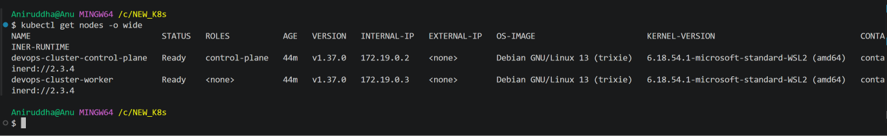
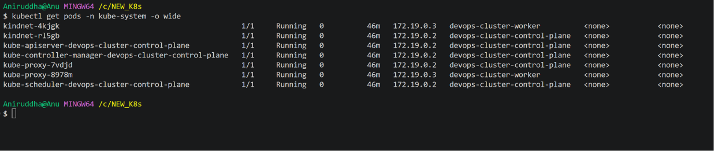

# Day 50 – Kubernetes Architecture and Cluster Setup

<escape>**Challenge:** 90 Days of DevOps – TrainWithShubham</escape>

**Day:** 50  
**Topic:** Kubernetes Architecture and Cluster Setup  
**Status:** Completed

---

# Table of Contents

1. [Introduction](#1-introduction)
2. [Task 1 – Recall the Kubernetes Story](#2-task-1--recall-the-kubernetes-story)
3. [Task 2 – Kubernetes Architecture](#3-task-2--kubernetes-architecture)
4. [Task 3 – Install kubectl](#4-task-3--install-kubectl)
5. [Task 4 – Set Up Local Kubernetes Cluster](#5-task-4--set-up-local-kubernetes-cluster)
6. [Task 5 – Explore the Kubernetes Cluster](#6-task-5--explore-the-kubernetes-cluster)
7. [Task 6 – Practice Cluster Lifecycle](#7-task-6--practice-cluster-lifecycle)
8. [Kubernetes Architecture Components – Practical Understanding](#8-kubernetes-architecture-components--practical-understanding)
9. [Important Kubernetes Commands](#9-important-kubernetes-commands)
10. [Interview Questions and Answers](#10-interview-questions-and-answers)
11. [Final Results](#11-final-results)
12. [Key Takeaways](#12-key-takeaways)

---

# 1. Introduction

In the previous days of the 90 Days of DevOps challenge, I learned how to build, run, and manage containers using Docker.

However, when applications grow and hundreds of containers need to run across multiple servers, managing them manually becomes difficult.

Docker helps us build and run containers, but we need an orchestration platform to manage containers across multiple machines.

This is where **Kubernetes** comes into the picture.

Kubernetes is an open-source container orchestration platform that automates:

- Container deployment.
- Application scaling.
- Container management.
- Self-healing.
- Load distribution and service discovery.
- Maintaining the desired state of applications.

In Day 50, I learned Kubernetes fundamentals, understood its architecture, installed and verified kubectl, created a local multi-node Kubernetes cluster using KIND, explored system components, and practised cluster lifecycle operations.

## My Learning Environment

| Component | Version / Details |
|---|---|
| Operating System | Windows 11 |
| Terminal | VS Code Git Bash |
| Container Platform | Docker Desktop |
| Docker Engine | 29.9.2 |
| Docker Desktop | 4.97.0 |
| Kubernetes CLI | kubectl v1.36.1 |
| KIND | v0.33.0 |
| Kubernetes Cluster | v1.37.0 |
| Kubernetes Runtime | containerd |
| Cluster Name | devops-cluster |
| Cluster Nodes | 1 Control Plane + 1 Worker |
| Cluster Driver | Docker |

---

# 2. Task 1 – Recall the Kubernetes Story

Before working with the terminal, I recalled the basic Kubernetes concepts from memory.

## 2.1 Why Was Kubernetes Created?

Managing a large number of containers manually becomes difficult when applications grow.

Docker allows us to create and run containers, but managing hundreds of containers across multiple servers requires additional orchestration capabilities.

For example:

- What happens if a container crashes?
- How do we automatically replace failed containers?
- How do we scale an application from 2 replicas to 10 replicas?
- How do we distribute workloads across multiple servers?
- How do we maintain application availability?

Kubernetes was created to solve these container orchestration challenges.

It automates deployment, scaling, management, and self-healing of containerized applications.

## 2.2 Who Created Kubernetes?

Kubernetes was originally developed by Google.

It was inspired by Google's internal container management system called **Borg**.

Google open-sourced Kubernetes in 2014, and it later became a Cloud Native Computing Foundation (CNCF) project.

## 2.3 What Does Kubernetes Mean?

The word Kubernetes comes from Greek and means **Helmsman or Pilot**.

A helmsman is someone who steers a ship.

Similarly, Kubernetes manages and coordinates containerized applications across a cluster.

The abbreviation **K8s** represents:

- K – First letter.
- 8 – Eight letters between K and s.
- s – Last letter.

Therefore, Kubernetes is commonly abbreviated as K8s.

---

# 3. Task 2 – Kubernetes Architecture

Kubernetes architecture is divided into two major parts:

1. Control Plane
2. Worker Nodes

The Control Plane manages the Kubernetes cluster, while Worker Nodes run application workloads.

## 3.1 Kubernetes Architecture Diagram

```text
                       Kubernetes Cluster
                               |
                 +-------------+-------------+
                 |                           |
          CONTROL PLANE                 WORKER NODES
                 |                           |
       +---------+---------+        +--------+--------+
       |         |         |        |                 |
   API Server   etcd   Scheduler  kubelet          kube-proxy
       |                           |                 |
       |                     Container Runtime       |
       |                       (containerd)          |
       |                           |                 |
       |                        Pods / Containers ---+
       |
 Controller Manager
       |
       +---- Deployment Controller
       +---- ReplicaSet Controller
       +---- Node Controller
       +---- Other Controllers
```

## 3.2 Control Plane Components

### 1. API Server

The API Server is the front door of the Kubernetes cluster.

Every Kubernetes API request goes through the API Server.

For example:

```bash
kubectl apply -f pod.yaml
```

When this command is executed, kubectl communicates with the API Server.

Responsibilities:

- Receives Kubernetes API requests.
- Validates requests.
- Handles authentication and authorization.
- Communicates with etcd.
- Provides the interface used by other Kubernetes components.

### 2. etcd

etcd is the distributed key-value database used by Kubernetes.

It stores persistent Kubernetes cluster state and configuration information.

Examples of information stored:

- Pods.
- Deployments.
- Services.
- ConfigMaps.
- Secrets.
- Node information.
- Other Kubernetes objects.

If etcd data is lost, Kubernetes can lose its persistent cluster state.

Therefore, etcd backups are important in production environments.

### 3. Scheduler

The Scheduler decides which Worker Node should run a newly created Pod.

It checks scheduling requirements such as:

- Available CPU and memory.
- Node selectors.
- Node affinity.
- Taints and tolerations.
- Other scheduling constraints.

The Scheduler selects a suitable node and records the Pod's node assignment through the API Server.

**Important:** The Scheduler does not directly start containers. Kubelet and the container runtime handle that responsibility.

### 4. Controller Manager

The Controller Manager runs different Kubernetes controllers.

Controllers continuously compare the actual cluster state with the desired state and take corrective actions.

This process is called **Reconciliation**.

Examples:

| Controller | Responsibility |
|---|---|
| Deployment Controller | Manages Deployments and ReplicaSets |
| ReplicaSet Controller | Maintains the desired number of Pod replicas |
| Node Controller | Monitors node health |
| Job Controller | Manages Job resources |
| Namespace Controller | Handles namespace lifecycle |

Example:

If a Deployment requires 3 replicas but only 2 Pods are running, the ReplicaSet Controller detects the difference and creates another Pod.

## 3.3 Worker Node Components

### 1. Kubelet

Kubelet is an agent that runs on every Kubernetes node.

Responsibilities:

- Communicates with the API Server.
- Watches for Pods assigned to its node.
- Ensures assigned Pods are running.
- Communicates with the container runtime.
- Reports Pod and node status.

Kubelet uses the Container Runtime Interface (CRI) to communicate with a compatible container runtime.

### 2. kube-proxy

kube-proxy is responsible for implementing Kubernetes Service networking rules on nodes.

It helps route network traffic to the appropriate backend Pods.

### 3. Container Runtime

The Container Runtime is responsible for running containers.

Examples:

- containerd
- CRI-O

Kubernetes communicates with the runtime through the Container Runtime Interface (CRI).

---

## 3.4 What Happens When We Execute kubectl apply?

Command:

```bash
kubectl apply -f pod.yaml
```

The basic workflow is:

1. kubectl sends the API request to the API Server.
2. API Server validates and processes the request.
3. The accepted Pod object is persisted in etcd.
4. Scheduler watches the API Server for unscheduled Pods.
5. Scheduler selects a suitable Worker Node.
6. Scheduler records the node assignment through the API Server.
7. Kubelet on the selected Worker Node notices the assigned Pod.
8. Kubelet communicates with the container runtime through CRI.
9. Container runtime pulls the image if required and starts the container.
10. Kubelet reports the Pod status through the API Server.

**Note:** When a Pod is created through a Deployment, the Deployment and ReplicaSet controllers also participate in creating and maintaining the required Pods.

## 3.5 What Happens If the API Server Goes Down?

If the API Server becomes unavailable:

- kubectl cannot communicate with the cluster.
- New Kubernetes API requests fail.
- Controllers and other components cannot perform their normal API Server interactions.
- Existing containers may continue running on Worker Nodes.
- Kubernetes management and reconciliation operations become impaired.

## 3.6 What Happens If a Worker Node Goes Down?

If a Worker Node becomes unavailable:

- Kubernetes detects the node health problem.
- Node Controller responds to the unhealthy node condition.
- Pods running on that node may become unavailable.
- Workload controllers maintain the desired replica count.
- Replacement Pods can be scheduled on other suitable healthy nodes.

The exact replacement timing depends on Kubernetes node monitoring, eviction, and toleration behaviour.

---

# 4. Task 3 – Install kubectl

kubectl is the command-line tool used to communicate with Kubernetes clusters.

It allows us to:

- Create Kubernetes resources.
- Deploy applications.
- Inspect Pods and Nodes.
- Manage Deployments and Services.
- Troubleshoot Kubernetes workloads.

I already had kubectl installed on my Windows machine.

## Verify kubectl Installation

Command:

```bash
kubectl version --client
```

My installed version:

```text
Client Version: v1.36.1
Kustomize Version: v5.8.1
```

kubectl installation was successful.

---

# 5. Task 4 – Set Up Local Kubernetes Cluster

For this challenge, I selected **KIND (Kubernetes in Docker)**.

## 5.1 Why Did I Choose KIND?

KIND allows us to create local Kubernetes clusters using Docker containers as Kubernetes nodes.

I selected KIND because:

- I already use Docker Desktop.
- It supports multi-node Kubernetes clusters.
- It is lightweight compared with running separate virtual machines.
- It is useful for local Kubernetes learning and testing.
- It allows us to practise control-plane and worker-node architecture on a local machine.

## 5.2 How KIND Works

KIND runs Kubernetes nodes as Docker containers.

My local environment looks like this:

```text
                  Windows 11
                      |
                Docker Desktop
                      |
                    WSL2
                      |
              Docker Containers
                      |
          +-----------+-----------+
          |                       |
   Control Plane Node       Worker Node
          |                       |
      Kubernetes              Kubernetes
      Components              Workloads
```

Each Docker container behaves as a Kubernetes node.

This allows us to create a multi-node Kubernetes cluster without requiring separate physical servers or virtual machines.

## 5.3 KIND Configuration

I created a configuration file named:

```text
kind-config.yml
```

Complete configuration:

```yaml
kind: Cluster
apiVersion: kind.x-k8s.io/v1alpha4
name: devops-cluster

nodes:
  - role: control-plane
    image: kindest/node:v1.37.0@sha256:a1ed56cfb0e7b93589bdf97c8cd566405a265939e3620fc4f5de89adff580ae5

  - role: worker
    image: kindest/node:v1.37.0@sha256:a1ed56cfb0e7b93589bdf97c8cd566405a265939e3620fc4f5de89adff580ae5
```

## 5.4 Understanding the KIND Configuration

### kind

```yaml
kind: Cluster
```

Specifies that we are creating a KIND cluster configuration.

### apiVersion

```yaml
apiVersion: kind.x-k8s.io/v1alpha4
```

Specifies the KIND configuration API version.

### Cluster Name

```yaml
name: devops-cluster
```

Defines the name of our Kubernetes cluster.

### Nodes

```yaml
nodes:
```

Defines the Kubernetes nodes that will be created.

### Control Plane

```yaml
- role: control-plane
```

Creates a Kubernetes control-plane node.

### Worker

```yaml
- role: worker
```

Creates a Kubernetes worker node.

### Node Image

```yaml
image: kindest/node:v1.37.0@sha256:...
```

Specifies the Kubernetes node image.

I pinned the image using its SHA256 digest so that the exact image content is used instead of relying only on a mutable image tag.

## 5.5 Verify the KIND Image

Before creating the cluster, I inspected the available image manifest.

```bash
docker manifest inspect kindest/node:v1.37.0
```

I also pulled the exact image using its digest:

```bash
docker pull kindest/node:v1.37.0@sha256:a1ed56cfb0e7b93589bdf97c8cd566405a265939e3620fc4f5de89adff580ae5
```

The image pull completed successfully.

To inspect the local image:

```bash
docker image ls --digests kindest/node
```

Output:

```text
REPOSITORY     TAG       DIGEST                                                                    IMAGE ID
kindest/node   <none>    sha256:a1ed56cfb0e7b93589bdf97c8cd566405a265939e3620fc4f5de89adff580ae5   a1ed56cfb0e7
```

The tag appeared as `<none>` because the image was pulled using its digest without assigning a local tag.

## 5.6 Create the KIND Cluster

Command:

```bash
kind create cluster --config kind-config.yml
```

Cluster creation output:

```text
Creating cluster "devops-cluster" ...
 ✓ Ensuring node image (kindest/node:v1.37.0)
 ✓ Preparing nodes
 ✓ Writing configuration
 ✓ Starting control-plane
 ✓ Installing CNI
 ✓ Installing StorageClass
 ✓ Joining worker nodes

Set kubectl context to "kind-devops-cluster"
```

The cluster was created successfully.

### Understanding the Creation Steps

| Step | Purpose |
|---|---|
| Ensuring node image | Checks the required Kubernetes node image |
| Preparing nodes | Creates the Docker containers representing nodes |
| Writing configuration | Configures the Kubernetes nodes |
| Starting control-plane | Starts the control-plane node |
| Installing CNI | Configures Pod networking |
| Installing StorageClass | Installs the default storage provisioner |
| Joining worker nodes | Adds worker nodes to the cluster |

## 5.7 Verify Cluster Creation

Check available KIND clusters:

```bash
kind get clusters
```

Output:

```text
devops-cluster
```

Check the current kubectl context:

```bash
kubectl config current-context
```

Output:

```text
kind-devops-cluster
```

Check Kubernetes nodes:

```bash
kubectl get nodes
```

Initial output:

```text
NAME                           STATUS   ROLES           AGE    VERSION
devops-cluster-control-plane   Ready    control-plane   109s   v1.37.0
devops-cluster-worker          Ready    <none>          95s    v1.37.0
```

Both Kubernetes nodes successfully joined the cluster and showed `Ready`.

---

# 6. Task 5 – Explore the Kubernetes Cluster

After creating the cluster, I explored its resources using kubectl.

## 6.1 Cluster Information

Command:

```bash
kubectl cluster-info
```

This displays information about the Kubernetes control plane and important cluster services.

## 6.2 List Kubernetes Nodes

Command:

```bash
kubectl get nodes
```

This displays all nodes registered in the cluster.

For more information:

```bash
kubectl get nodes -o wide
```

Initial output:

```text
NAME                           STATUS   ROLES           AGE    VERSION   INTERNAL-IP   EXTERNAL-IP   OS-IMAGE
devops-cluster-control-plane   Ready    control-plane   109s   v1.37.0   172.19.0.3    <none>        Debian GNU/Linux 13
devops-cluster-worker          Ready    <none>          95s    v1.37.0   172.19.0.2    <none>        Debian GNU/Linux 13
```

Important observations:

- The cluster contains two nodes.
- Both nodes are Ready.
- Kubernetes version is v1.37.0.
- Control-plane IP is 172.19.0.3.
- Worker IP is 172.19.0.2.
- Both nodes use containerd as their container runtime.
- The nodes run Debian GNU/Linux 13 inside KIND.

## 6.3 Describe a Node

Command:

```bash
kubectl describe node devops-cluster-worker
```

This command displays detailed information about a particular Kubernetes node.

Important fields:

| Field | Meaning |
|---|---|
| Name | Kubernetes node name |
| Roles | Node role |
| Labels | Labels assigned to the node |
| Taints | Scheduling restrictions |
| Conditions | Current node health conditions |
| Addresses | Node IP information |
| Capacity | Total node-reported resources |
| Allocatable | Resources available for Pods |
| System Info | OS, kernel and runtime information |
| Non-terminated Pods | Pods currently assigned to the node |
| Events | Important node-related events |

Important observations from my worker node:

```text
Name: devops-cluster-worker

Taints: <none>

Unschedulable: false

Conditions:
  MemoryPressure False
  DiskPressure False
  PIDPressure False
  Ready True

InternalIP: 172.19.0.2

Capacity:
  cpu: 16
  memory: 7972764Ki
  pods: 110

Allocatable:
  cpu: 16
  memory: 7972764Ki
  pods: 110

Container Runtime Version: containerd://2.3.4
Kubelet Version: v1.37.0

PodCIDR: 10.244.1.0/24
```

**Important:** The reported CPU and memory values represent the resources visible to the Kubernetes node. They are part of the shared Docker Desktop/WSL2 environment, not dedicated physical resources.

## 6.4 List All Namespaces

Command:

```bash
kubectl get namespaces
```

Output:

```text
NAME                 STATUS   AGE
default              Active   24m
kube-node-lease      Active   24m
kube-public          Active   24m
kube-system          Active   24m
local-path-storage   Active   24m
```

### Understanding Namespaces

Namespaces logically organize Kubernetes resources inside a cluster.

| Namespace | Purpose |
|---|---|
| default | Default namespace for resources when no namespace is specified |
| kube-system | Contains Kubernetes system components |
| kube-public | Contains publicly readable cluster information |
| kube-node-lease | Stores Lease objects used for node heartbeats |
| local-path-storage | Contains the local-path storage provisioner |

Namespaces help organize resources, but they are not complete security boundaries by themselves.

## 6.5 List All Pods Across All Namespaces

Command:

```bash
kubectl get pods -A
```

The `-A` flag is short for:

```bash
kubectl get pods --all-namespaces
```

Output:

```text
NAMESPACE            NAME                                                   READY   STATUS    RESTARTS
kube-system          coredns-559f6c778d-jkjbb                               1/1     Running   0
kube-system          coredns-559f6c778d-wwmms                               1/1     Running   0
kube-system          etcd-devops-cluster-control-plane                      1/1     Running   0
kube-system          kindnet-2vzhv                                          1/1     Running   0
kube-system          kindnet-8mw2g                                          1/1     Running   0
kube-system          kube-apiserver-devops-cluster-control-plane            1/1     Running   0
kube-system          kube-controller-manager-devops-cluster-control-plane   1/1     Running   0
kube-system          kube-proxy-jxtxv                                       1/1     Running   0
kube-system          kube-proxy-v8vzt                                       1/1     Running   0
kube-system          kube-scheduler-devops-cluster-control-plane            1/1     Running   0
local-path-storage   local-path-provisioner-75f7fc7dc5-dtps8                1/1     Running   0
```

## 6.6 Explore kube-system Pods

Command:

```bash
kubectl get pods -n kube-system
```

The `kube-system` namespace contains important Kubernetes system components.

To see additional information:

```bash
kubectl get pods -n kube-system -o wide
```

## 6.7 Understanding kube-system Components

### 1. kube-apiserver

The API Server is the main entry point for Kubernetes API requests.

It handles communication between kubectl and the Kubernetes control plane.

### 2. etcd

etcd stores persistent Kubernetes cluster state.

It is the database used by Kubernetes to store cluster information.

### 3. kube-scheduler

The Scheduler selects a suitable Worker Node for newly created Pods.

It considers resource availability and scheduling requirements.

### 4. kube-controller-manager

Runs Kubernetes controllers that maintain the desired cluster state.

Examples include:

- Deployment Controller.
- ReplicaSet Controller.
- Node Controller.

### 5. CoreDNS

CoreDNS provides DNS-based service discovery inside the Kubernetes cluster.

It allows applications to discover Services using DNS names instead of relying on manually configured IP addresses.

My cluster had two CoreDNS Pods.

### 6. kindnet

kindnet is the CNI networking component used by KIND.

It configures Pod networking so that Pods can communicate across Kubernetes nodes.

My cluster had two kindnet Pods because the DaemonSet runs one Pod on each eligible node.

### 7. kube-proxy

kube-proxy implements Kubernetes Service networking rules.

It helps route traffic to the appropriate backend Pods.

My cluster had two kube-proxy Pods, one for each node.

### 8. local-path-provisioner

The local-path-provisioner provides local storage provisioning for Kubernetes PersistentVolumeClaims.

It allows workloads to request persistent storage backed by local node directories.

## 6.8 Deployment, DaemonSet and StatefulSet Exploration

I also inspected the workload controllers running in the cluster.

### Deployments

Command:

```bash
kubectl get deploy -A
```

Output:

```text
NAMESPACE            NAME                     READY   UP-TO-DATE   AVAILABLE
kube-system          coredns                  2/2     2            2
local-path-storage   local-path-provisioner   1/1     1            1
```

A Deployment manages ReplicaSets and provides application rollout and rollback capabilities.

### DaemonSets

Command:

```bash
kubectl get daemonsets -A
```

Output:

```text
NAMESPACE     NAME         DESIRED   CURRENT   READY   UP-TO-DATE   AVAILABLE
kube-system   kindnet      2         2         2       2            2
kube-system   kube-proxy   2         2         2       2            2
```

A DaemonSet ensures that a Pod runs on each eligible node.

Examples include:

- Monitoring agents.
- Logging agents.
- Networking agents.

### StatefulSets

Command:

```bash
kubectl get statefulsets -A
```

Output:

```text
No resources found
```

There were no StatefulSets running in my cluster.

StatefulSets are useful for applications that require stable Pod identities and persistent storage, such as databases.

---

# 7. Task 6 – Practice Cluster Lifecycle

In this task, I practised deleting and recreating the KIND cluster and explored Kubernetes contexts and kubeconfig.

## 7.1 Delete the Existing Cluster

Command:

```bash
kind delete cluster --name devops-cluster
```

Output:

```text
Deleting cluster "devops-cluster" ...
Deleted nodes: ["devops-cluster-worker" "devops-cluster-control-plane"]
```

The cluster was successfully deleted.

KIND removed the Docker containers representing the Kubernetes control-plane and worker nodes.

This did not uninstall Docker, KIND, or kubectl.

My `kind-config.yml` file also remained available.

## 7.2 Recreate the Cluster

I recreated the cluster using the same configuration file.

Command:

```bash
kind create cluster --config kind-config.yml
```

Output:

```text
Creating cluster "devops-cluster" ...
 ✓ Ensuring node image (kindest/node:v1.37.0)
 ✓ Preparing nodes
 ✓ Writing configuration
 ✓ Starting control-plane
 ✓ Installing CNI
 ✓ Installing StorageClass
 ✓ Joining worker nodes

Set kubectl context to "kind-devops-cluster"
```

The cluster was successfully recreated.

## 7.3 Verify the Recreated Cluster

Command:

```bash
kubectl get nodes
```

Output:

```text
NAME                           STATUS   ROLES           AGE    VERSION
devops-cluster-control-plane   Ready    control-plane   114s   v1.37.0
devops-cluster-worker          Ready    <none>          100s   v1.37.0
```

Both nodes returned to the Ready state.

## 7.4 Verify Cluster Information

Command:

```bash
kubectl cluster-info
```

Output:

```text
Kubernetes control plane is running at https://127.0.0.1:58091

CoreDNS is running at https://127.0.0.1:58091/api/v1/namespaces/kube-system/services/kube-dns:dns/proxy
```

The output confirmed that the Kubernetes control plane and CoreDNS were running.

## 7.5 Check Current Context

Command:

```bash
kubectl config current-context
```

Output:

```text
kind-devops-cluster
```

This command displays the currently active Kubernetes context.

It tells kubectl which context to use by default.

## 7.6 List Available Contexts

Command:

```bash
kubectl config get-contexts
```

Output:

```text
CURRENT   NAME                  CLUSTER               AUTHINFO              NAMESPACE
*         kind-devops-cluster   kind-devops-cluster   kind-devops-cluster
```

### Understanding the Output

| Column | Meaning |
|---|---|
| CURRENT | `*` indicates the currently active context |
| NAME | Context name |
| CLUSTER | Kubernetes cluster associated with the context |
| AUTHINFO | User credentials associated with the context |
| NAMESPACE | Default namespace; blank means the default namespace is used |

## 7.7 What Is a Kubernetes Context?

A Kubernetes context is a configuration profile that combines:

1. Cluster – Which Kubernetes cluster to connect to.
2. User – Which authentication credentials to use.
3. Namespace – Which namespace to use by default.

A context allows kubectl to work with different Kubernetes clusters and users without manually specifying connection details for every command.

## 7.8 View Kubeconfig

Command:

```bash
kubectl config view
```

Output:

```yaml
apiVersion: v1
clusters:
- cluster:
    certificate-authority-data:
    server: https://127.0.0.1:58091
  name: kind-devops-cluster
contexts:
- context:
    cluster: kind-devops-cluster
    user: kind-devops-cluster
  name: kind-devops-cluster
current-context: kind-devops-cluster
kind: Config
users:
- name: kind-devops-cluster
  user:
    client-certificate-data:
    client-key-data:
```

## 7.9 What Is Kubeconfig?

Kubeconfig is a configuration file used by kubectl to connect to Kubernetes clusters and authenticate with them.

It contains:

- Cluster connection information.
- API Server endpoint.
- Certificate authority information.
- User authentication credentials.
- Context information.
- Current context.

### Important Kubeconfig Sections

#### clusters

Contains information about Kubernetes clusters.

Example:

```yaml
clusters:
- cluster:
    server: https://127.0.0.1:58091
  name: kind-devops-cluster
```

The `server` field specifies the API Server endpoint.

#### contexts

Combines a cluster and user configuration.

Example:

```yaml
contexts:
- context:
    cluster: kind-devops-cluster
    user: kind-devops-cluster
  name: kind-devops-cluster
```

#### current-context

Specifies the context kubectl uses by default.

Example:

```yaml
current-context: kind-devops-cluster
```

#### users

Contains authentication information.

It can include:

- Client certificates.
- Client private keys.
- Authentication tokens.
- Other supported authentication configuration.

**Security:** Kubeconfig can contain sensitive authentication credentials. It should not be committed to a public GitHub repository or shared without removing sensitive information.

## 7.10 Where Is Kubeconfig Stored?

The default kubeconfig location is:

```text
~/.kube/config
```

On Windows, this normally resolves to:

```text
C:\Users\<username>\.kube\config
```

In Git Bash, `~` represents the user's home directory.

To check the home directory:

```bash
echo $HOME
```

To check whether the kubeconfig file exists:

```bash
ls -l ~/.kube/config
```

---

# 8. Kubernetes Architecture Components – Practical Understanding

During this challenge, I also inspected the actual static Pod manifests running on my KIND control-plane node.

The main control-plane components were running as Pods inside the `kube-system` namespace.

## 8.1 Static Pods

Static Pods are managed directly by kubelet on a particular node.

Unlike ordinary Pods, they are not created through the normal API Server scheduling workflow.

The kubelet watches a configured static Pod manifest directory and ensures the specified Pods are running.

In a kubeadm-based setup, a common directory is:

```text
/etc/kubernetes/manifests/
```

The path can be configured differently depending on the Kubernetes environment.

Typical control-plane static Pod manifests include:

```text
kube-apiserver.yaml
etcd.yaml
kube-scheduler.yaml
kube-controller-manager.yaml
```

Static Pods may also appear in the API Server as mirror Pods.

## 8.2 API Server Manifest

I inspected:

```text
/etc/kubernetes/manifests/kube-apiserver.yaml
```

Important configuration values included:

```yaml
image: registry.k8s.io/kube-apiserver:v1.37.0

--secure-port=6443

--etcd-servers=https://127.0.0.1:2379

--service-cluster-ip-range=10.96.0.0/16

hostNetwork: true
```

Important observations:

- API Server runs using its own Kubernetes component image.
- Port 6443 is the secure API Server port inside the control-plane node environment.
- It connects to etcd using the configured endpoint.
- `service-cluster-ip-range` defines the Service IP range.
- `hostNetwork: true` allows the API Server Pod to share the control-plane node's network namespace.

## 8.3 etcd Manifest

I inspected:

```text
/etc/kubernetes/manifests/etcd.yaml
```

Important configuration values included:

```yaml
--data-dir=/var/lib/etcd

--listen-client-urls=https://127.0.0.1:2379,https://172.19.0.3:2379

--listen-peer-urls=https://172.19.0.3:2380

--advertise-client-urls=https://172.19.0.3:2379

hostNetwork: true
```

Important observations:

- `/var/lib/etcd` stores etcd database data.
- Port 2379 is used for client communication.
- Port 2380 is used for etcd peer communication.
- API Server communicates with etcd using the configured client endpoint.
- TLS certificates protect etcd communication.

## 8.4 Scheduler Manifest

I inspected:

```text
/etc/kubernetes/manifests/kube-scheduler.yaml
```

Important configuration values included:

```yaml
--authentication-kubeconfig=/etc/kubernetes/scheduler.conf

--authorization-kubeconfig=/etc/kubernetes/scheduler.conf

--bind-address=127.0.0.1

--kubeconfig=/etc/kubernetes/scheduler.conf

--leader-elect=true
```

Important observations:

- Scheduler uses kubeconfig to communicate with the API Server.
- Authentication and authorization are separate concepts.
- `--leader-elect=true` enables leader election.
- In a highly available control plane, one eligible Scheduler instance becomes the active leader while other instances remain standby candidates.

## 8.5 Controller Manager Manifest

I inspected:

```text
/etc/kubernetes/manifests/kube-controller-manager.yaml
```

Important configuration values included:

```yaml
--allocate-node-cidrs=true

--cluster-cidr=10.244.0.0/16

--leader-elect=true

--service-cluster-ip-range=10.96.0.0/16
```

Important observations:

- `--allocate-node-cidrs=true` enables per-node Pod CIDR allocation.
- `--cluster-cidr=10.244.0.0/16` specifies the overall Pod network range.
- `--service-cluster-ip-range=10.96.0.0/16` specifies the Service IP range.
- Leader election prevents multiple eligible Controller Manager instances from simultaneously acting as active leaders for leader-elected controller operations.

---

# 9. Important Kubernetes Commands

These are the commands practised during Day 50.

| Command | Purpose |
|---|---|
| `kubectl version --client` | Check kubectl client version |
| `kind get clusters` | List KIND clusters |
| `kind create cluster --config kind-config.yml` | Create cluster using configuration |
| `kind delete cluster --name devops-cluster` | Delete KIND cluster |
| `kubectl cluster-info` | Display cluster information |
| `kubectl get nodes` | List Kubernetes nodes |
| `kubectl get nodes -o wide` | Display detailed node information |
| `kubectl describe node <node-name>` | Describe a particular node |
| `kubectl get namespaces` | List namespaces |
| `kubectl get pods -A` | List Pods across all namespaces |
| `kubectl get pods -n kube-system` | List system Pods |
| `kubectl get pods -n kube-system -o wide` | Display system Pod details |
| `kubectl get deploy -A` | List Deployments |
| `kubectl get daemonsets -A` | List DaemonSets |
| `kubectl get statefulsets -A` | List StatefulSets |
| `kubectl config current-context` | Display current context |
| `kubectl config get-contexts` | List available contexts |
| `kubectl config view` | Display kubeconfig information |
| `echo $HOME` | Display Git Bash home directory |
| `ls -l ~/.kube/config` | Check kubeconfig file |

---

# 10. Interview Questions and Answers

## Q1. What is Kubernetes?

Kubernetes is an open-source container orchestration platform that automates the deployment, scaling, and management of containerized applications.

## Q2. Why do we need Kubernetes when we already have Docker?

Docker helps us build and run containers, while Kubernetes manages containerized applications across multiple nodes.

Kubernetes provides orchestration capabilities such as automated scaling, self-healing, scheduling, and service discovery.

## Q3. What is a Kubernetes cluster?

A Kubernetes cluster is a group of nodes that work together to run containerized applications.

It consists of a Control Plane and Worker Nodes.

## Q4. What is a Kubernetes node?

A node is a physical or virtual machine that participates in a Kubernetes cluster.

In KIND, each Kubernetes node runs as a Docker container.

## Q5. What is the difference between a Control Plane and a Worker Node?

The Control Plane manages the Kubernetes cluster and its desired state.

Worker Nodes run application workloads inside Pods.

## Q6. What is the responsibility of the API Server?

The API Server is the front door of Kubernetes.

It receives, validates, and processes Kubernetes API requests and provides communication between cluster components.

## Q7. What is etcd?

etcd is the distributed key-value database used by Kubernetes to store persistent cluster state.

## Q8. What is the responsibility of the Scheduler?

The Scheduler selects a suitable Worker Node for a newly created Pod based on scheduling requirements.

## Q9. What is the responsibility of Controller Manager?

Controller Manager runs controllers that continuously compare actual state with desired state and take corrective actions.

## Q10. What is reconciliation?

Reconciliation is the continuous process in which Kubernetes controllers compare actual cluster state with desired state and take actions to make them match.

## Q11. What is kubelet?

Kubelet is an agent running on every Kubernetes node.

It watches the API Server for Pods assigned to its node and ensures that their containers are running.

## Q12. What is kube-proxy?

kube-proxy implements Kubernetes Service networking rules and helps route traffic to backend Pods.

## Q13. What is a container runtime?

A container runtime is responsible for running containers.

Examples include containerd and CRI-O.

## Q14. What is CNI?

CNI stands for Container Network Interface.

It provides the networking configuration required for Kubernetes Pods to communicate.

## Q15. What is a namespace?

A namespace is a logical way to organize Kubernetes resources inside a cluster.

Examples include `default` and `kube-system`.

## Q16. What is a static Pod?

A static Pod is managed directly by kubelet on a particular node using a local manifest file.

## Q17. What is the difference between a Pod CIDR and Service CIDR?

Pod CIDR is the IP address range used for Pod networking.

Service CIDR is the IP address range used for Kubernetes Service virtual IP addresses, such as ClusterIP.

In my cluster:

```text
Pod CIDR:     10.244.0.0/16
Service CIDR: 10.96.0.0/16
```

## Q18. What is kubeconfig?

Kubeconfig is a configuration file used by kubectl to connect to Kubernetes clusters and authenticate with them.

It contains cluster details, user credentials, and contexts.

## Q19. What is a Kubernetes context?

A context combines cluster, user, and namespace information.

It tells kubectl which cluster and credentials to use.

## Q20. What happens if the API Server goes down?

kubectl cannot communicate with the cluster, and normal API-based cluster management operations become unavailable or impaired.

Existing containers may continue running.

## Q21. Does the Scheduler directly communicate with kubelet?

No.

The Scheduler selects a suitable node and records the Pod assignment through the API Server.

Kubelet independently watches the API Server and notices Pods assigned to its node.

## Q22. Does Controller Manager directly start application containers?

No.

Controllers create or update Kubernetes objects through the API Server.

The Scheduler selects a node, kubelet manages the Pod on that node, and the container runtime starts the containers.

---

# 11. Final Results

## 11.1 Cluster Verification

After completing the cluster lifecycle task, I recreated my cluster and verified that both nodes were Ready.

Final verification command:

```bash
kubectl get nodes
```

Output:

```text
NAME                           STATUS   ROLES           AGE    VERSION
devops-cluster-control-plane   Ready    control-plane   114s   v1.37.0
devops-cluster-worker          Ready    <none>          100s   v1.37.0
```

## 11.2 Expected Screenshots

The following screenshots should be captured from the final recreated cluster and added to this directory:

```text
2026/
└── day-50/
    ├── day-50-k8s-setup.md
    └── screenshots/
        ├── kubectl-get-nodes.png
        └── kubectl-get-pods-kube-system.png
```

### Screenshot 1 – Kubernetes Nodes

Capture the output of:

```bash
kubectl get nodes
```



### Screenshot 2 – kube-system Pods

Capture the output of:

```bash
kubectl get pods -n kube-system
```



**Note:** The image paths above are placeholders for the actual screenshots. Capture the terminal outputs and save the images using these filenames before submitting the documentation.

## 11.3 Final Challenge Checklist

### Task 1 – Recall the Kubernetes Story

- [x] Understand why Kubernetes was created.
- [x] Understand Google's Borg system.
- [x] Understand the meaning of Kubernetes and K8s.

### Task 2 – Draw the Kubernetes Architecture

- [x] Understand Control Plane components.
- [x] Understand Worker Node components.
- [x] Understand the `kubectl apply` request flow.
- [x] Understand API Server failure scenarios.
- [x] Understand Worker Node failure scenarios.

### Task 3 – Install kubectl

- [x] kubectl installed.
- [x] Verified kubectl version.

### Task 4 – Set Up Local Cluster

- [x] Selected KIND.
- [x] Created custom KIND configuration.
- [x] Created a multi-node cluster.
- [x] Verified cluster information.
- [x] Verified both nodes were Ready.

### Task 5 – Explore Cluster

- [x] Explored cluster information.
- [x] Listed Kubernetes nodes.
- [x] Described a Worker Node.
- [x] Listed namespaces.
- [x] Listed Pods across all namespaces.
- [x] Explored kube-system Pods.
- [x] Identified Kubernetes architecture components.
- [x] Explored Deployments.
- [x] Explored DaemonSets.
- [x] Explored StatefulSets.

### Task 6 – Practice Cluster Lifecycle

- [x] Deleted the existing KIND cluster.
- [x] Recreated the cluster.
- [x] Verified both nodes were Ready.
- [x] Checked current context.
- [x] Listed available contexts.
- [x] Viewed kubeconfig.
- [x] Understood kubeconfig storage location.

### Expected Deliverables

- [x] Kubernetes history documented.
- [x] Kubernetes architecture diagram documented.
- [x] KIND selection and reason documented.
- [x] Cluster information documented.
- [x] kube-system component responsibilities documented.
- [ ] Actual `kubectl get nodes` screenshot added.
- [ ] Actual `kubectl get pods -n kube-system` screenshot added.
- [ ] Commit and push to GitHub.

---

# 12. Key Takeaways

Day 50 was my introduction to Kubernetes architecture and local cluster management.

The most important concepts I learned:

1. Kubernetes is a container orchestration platform.
2. A Kubernetes cluster consists of a Control Plane and Worker Nodes.
3. API Server is the entry point for Kubernetes API requests.
4. etcd stores persistent Kubernetes cluster state.
5. Scheduler selects suitable nodes for Pods.
6. Controller Manager maintains the desired cluster state.
7. Kubelet manages Pods assigned to its node.
8. kube-proxy implements Service networking rules.
9. CNI provides Pod networking.
10. KIND allows us to run multi-node Kubernetes clusters using Docker containers.
11. Namespaces logically organize Kubernetes resources.
12. Kubeconfig allows kubectl to connect to Kubernetes clusters and authenticate.

The biggest learning from this day was understanding how the different Kubernetes components work together to manage containerized applications.

I also created and successfully recreated my first local multi-node Kubernetes cluster using KIND.

**Day 50 completed!**

The Kubernetes orchestration journey has officially begun. 🚀

---

# Learn in Public

Started my Kubernetes journey today!

Set up my first local multi-node Kubernetes cluster using KIND, explored the Kubernetes architecture, and saw the control-plane components running as actual Pods.

Learned how API Server, etcd, Scheduler, Controller Manager, kubelet, and kube-proxy work together to manage containerized applications.

Also practised cluster lifecycle operations, explored kube-system components, and understood kubeconfig and Kubernetes contexts.

The orchestration chapter begins!

#90DaysOfDevOps #DevOpsKaJosh #TrainWithShubham #Kubernetes #K8s #DevOps #Docker