# Day 52 – Kubernetes Namespaces and Deployments

## Overview

On Day 52 of the 90 Days of DevOps challenge, I learned about Kubernetes Namespaces and Deployments.

Previously, I worked with standalone Pods. However, standalone Pods are not automatically recreated when deleted. To solve this problem, Kubernetes provides Deployments, which manage ReplicaSets and maintain the desired number of Pods.

I also explored Kubernetes Namespaces to organize resources within a cluster and practiced scaling, rolling updates, and rollbacks.

## Environment

- OS: Windows 11
- Terminal: Git Bash (VS Code)
- Kubernetes Cluster: KIND
- Cluster Name: devops-cluster
- Context: kind-devops-cluster
- Kubernetes Version: v1.37.0
- Container Runtime: Docker Desktop

---

## Task 1 – Explore Default Namespaces

First, I listed all namespaces available in my Kubernetes cluster.

```bash
kubectl get namespaces
```

### Default Kubernetes Namespaces

| Namespace | Purpose |
|---|---|
| default | Namespace where resources are created when no namespace is specified. |
| kube-system | Contains Kubernetes internal components. |
| kube-public | Contains publicly readable resources. |
| kube-node-lease | Used for node heartbeat tracking. |
| local-path-storage | Created by the local-path storage provisioner in my KIND cluster. |

Next, I checked the Pods running inside the `kube-system` namespace.

```bash
kubectl get pods -n kube-system
```

### Observation

I found 10 Pods running inside the `kube-system` namespace.

These included:

- CoreDNS
- etcd
- kube-apiserver
- kube-controller-manager
- kube-scheduler
- kube-proxy
- kindnet

All 10 Pods were in the `Running` state with `1/1` containers ready.

**Learning:** The `kube-system` namespace contains important Kubernetes components responsible for cluster operations. These resources should not be modified or deleted unnecessarily.

### Screenshot

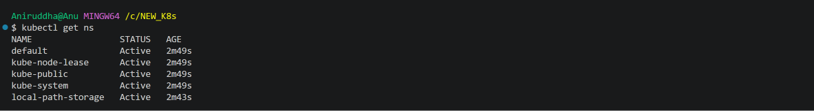

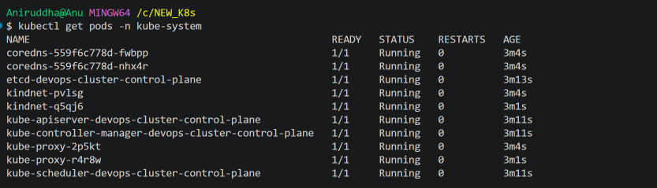

---

## Task 2 – Create and Use Custom Namespaces

Namespaces provide logical separation and organization of resources within a Kubernetes cluster.

I created two custom namespaces for development and staging environments.

```bash
kubectl create namespace dev
kubectl create namespace staging
```

I verified the namespaces:

```bash
kubectl get namespaces
```

### Create a Namespace Using YAML

I also created a namespace using a declarative YAML manifest.

File: `manifests/namespaces.yml`

```yaml
apiVersion: v1
kind: Namespace
metadata:
  name: production
```

Applied the manifest:

```bash
kubectl apply -f manifests/namespaces.yml
```

Verified:

```bash
kubectl get namespaces
```

### Create Pods in Different Namespaces

I created an Nginx Pod in the development namespace.

```bash
kubectl run nginx-dev --image=nginx:latest -n dev
```

Then I created another Nginx Pod in the staging namespace.

```bash
kubectl run nginx-staging --image=nginx:latest -n staging
```

To verify the Pods, I used:

```bash
kubectl get pods
kubectl get pods -n dev
kubectl get pods -n staging
kubectl get pods -A
```

### Observation

- `kubectl get pods` displays Pods from the current namespace.
- `kubectl get pods -n dev` displays Pods from the development namespace.
- `kubectl get pods -n staging` displays Pods from the staging namespace.
- `kubectl get pods -A` displays Pods across all namespaces.

**Learning:** Namespaces logically organize resources within the same Kubernetes cluster. They do not create separate clusters.

### Screenshot

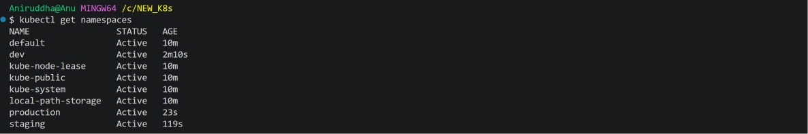

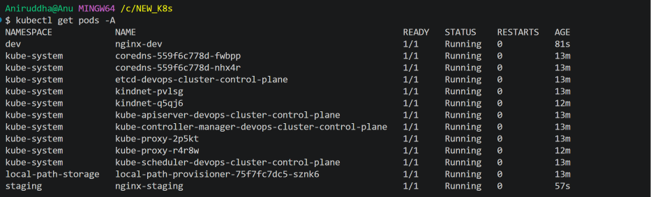

---

## Task 3 – Create Your First Deployment

A Deployment is a Kubernetes resource that manages ReplicaSets and maintains the desired number of Pod replicas.

Unlike standalone Pods, Deployments provide self-healing capabilities. If a Pod gets deleted, the ReplicaSet creates a replacement Pod to maintain the desired replica count.

I created an Nginx Deployment with three replicas in the `dev` namespace.

File: `manifests/nginx-deployment.yaml`

```yaml
apiVersion: apps/v1
kind: Deployment

metadata:
  name: nginx-deployment
  namespace: dev
  labels:
    app: nginx

spec:
  replicas: 3

  selector:
    matchLabels:
      app: nginx

  template:
    metadata:
      labels:
        app: nginx

    spec:
      containers:
        - name: nginx
          image: nginx:1.24
          ports:
            - containerPort: 80
```

### Explanation of the Deployment Manifest

| Field | Explanation |
|---|---|
| apiVersion | `apps/v1` is the API version used for Deployments. |
| kind | Defines the resource type as Deployment. |
| metadata.name | Name of the Deployment. |
| metadata.namespace | Namespace in which the Deployment is created. |
| replicas | Desired number of Pod replicas. |
| selector.matchLabels | Identifies the Pods managed by the Deployment. |
| template | Blueprint used by the Deployment to create Pods. |
| template.metadata.labels | Labels assigned to the created Pods. |
| containers | Defines the container configuration. |
| image | Nginx container image and version. |
| containerPort | Documents the application container's port. |

**Important:** The labels in `spec.selector.matchLabels` must match the labels in `spec.template.metadata.labels`.

### Apply the Deployment

```bash
kubectl apply -f manifests/nginx-deployment.yaml
```

Verified the Deployment:

```bash
kubectl get deployments -n dev
```

Output:

```text
NAME               READY   UP-TO-DATE   AVAILABLE   AGE
nginx-deployment   3/3     3            3           ...
```

Checked ReplicaSets:

```bash
kubectl get replicasets -n dev
```

Checked Pods:

```bash
kubectl get pods -n dev
```

### Understanding Deployment Columns

| Column | Meaning |
|---|---|
| NAME | Name of the Deployment. |
| READY | Number of ready replicas compared to the desired replicas. |
| UP-TO-DATE | Number of replicas updated to match the latest Deployment specification. |
| AVAILABLE | Number of replicas available to serve the application. |
| AGE | Time since the Deployment was created. |

### Understanding Deployment, ReplicaSet and Pods

The relationship between these resources is:

```text
Deployment
    |
    v
ReplicaSet
    |
    v
Pods
```

- Deployment manages ReplicaSets.
- ReplicaSet maintains the desired number of Pods.
- Pods run the application containers.

### Screenshot

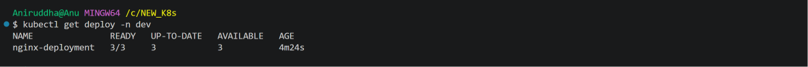

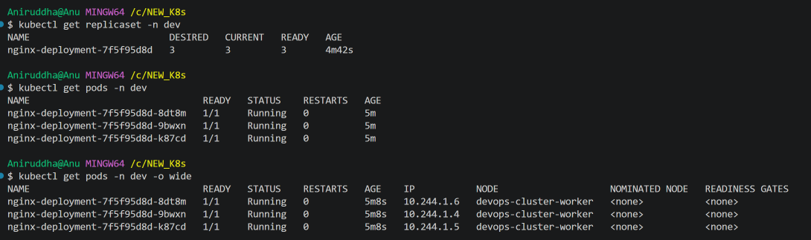

---

## Task 4 – Self-Healing: Delete a Pod

To understand the self-healing capability of Deployments, I deleted one of the Pods managed by the Deployment.

First, I listed the Pods:

```bash
kubectl get pods -n dev
```

Deleted one Pod:

```bash
kubectl delete pod nginx-deployment-7f5f95d8d-9bwxn -n dev
```

Checked the Pods again:

```bash
kubectl get pods -n dev
```

### Observation

The deleted Pod was not restored with the same name.

Instead, the ReplicaSet detected that the actual number of Pods was lower than the desired number of three and created a replacement Pod.

The replacement Pod had a different name:

```text
Deleted Pod:
nginx-deployment-7f5f95d8d-9bwxn

Replacement Pod:
nginx-deployment-7f5f95d8d-jbnsd
```

The Deployment returned to three running replicas.

**Learning:**

- Standalone Pods are not automatically recreated after deletion.
- Pods managed by a Deployment are recreated through the ReplicaSet.
- Kubernetes maintains the desired state by continuously reconciling the actual state with the desired state.

---

## Task 5 – Scale the Deployment

Scaling allows us to increase or decrease the number of application replicas according to our requirements.

I initially had three replicas.

### Scale Up: 3 to 5 Replicas

```bash
kubectl scale deployment nginx-deployment --replicas=5 -n dev
```

Verified:

```bash
kubectl get deployments -n dev
kubectl get pods -n dev
```

Two additional Pods were created, bringing the total to five replicas.

### Scale Down: 5 to 2 Replicas

```bash
kubectl scale deployment nginx-deployment --replicas=2 -n dev
```

Verified:

```bash
kubectl get deployments -n dev
kubectl get pods -n dev
```

### Observation

When scaling down from five replicas to two, Kubernetes terminated the extra three Pods and stopped their container processes.

The Deployment and ReplicaSet remained active with two desired replicas.

### Imperative and Declarative Scaling

**Imperative scaling:**

We directly tell Kubernetes to change the replica count using a command.

```bash
kubectl scale deployment nginx-deployment --replicas=5 -n dev
```

**Declarative scaling:**

We modify the `replicas` field in the Deployment YAML manifest and apply the updated configuration.

```yaml
spec:
  replicas: 4
```

Apply the updated manifest:

```bash
kubectl apply -f manifests/nginx-deployment.yaml
```

**Learning:** Kubernetes creates or terminates Pods to match the desired replica count.

### Screenshot

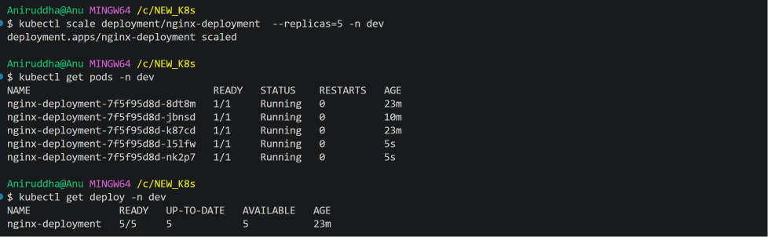

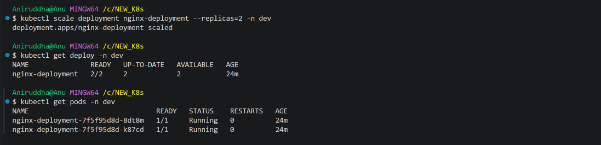

---

## Task 6 – Rolling Update and Rollback

Rolling updates allow us to update an application's container image gradually without replacing all existing Pods at once.

My Deployment initially used:

```yaml
image: nginx:1.24
```

I updated the image to `nginx:1.25` using the imperative command.

### Trigger Rolling Update

```bash
kubectl set image deployment/nginx-deployment nginx=nginx:1.25 -n dev
```

### Monitor Rollout Status

```bash
kubectl rollout status deployment/nginx-deployment -n dev
```

Output:

```text
deployment "nginx-deployment" successfully rolled out
```

### Check Pods and ReplicaSets

```bash
kubectl get pods -n dev
kubectl get replicasets -n dev
```

### Observation

Kubernetes created a new ReplicaSet for the updated image.

The old ReplicaSet was scaled down to zero replicas after the rollout completed.

| ReplicaSet | Desired | Current | Image |
|---|---:|---:|---|
| nginx-deployment-7f5f95d8d | 0 | 0 | nginx:1.24 |
| nginx-deployment-6946987795 | 2 | 2 | nginx:1.25 |

The Deployment was scaled to two replicas before performing this update, so the rolling update managed two replicas.

### Check Rollout History

```bash
kubectl rollout history deployment/nginx-deployment -n dev
```

Output:

```text
REVISION  CHANGE-CAUSE
1         <none>
2         <none>
```

The Deployment had two recorded revisions.

### Rollback to Previous Version

To restore the previous Deployment revision, I executed:

```bash
kubectl rollout undo deployment/nginx-deployment -n dev
```

Checked the rollback status:

```bash
kubectl rollout status deployment/nginx-deployment -n dev
```

Verified the container image:

```bash
kubectl describe deployment nginx-deployment -n dev | grep Image
```

Output:

```text
Image: nginx:1.24
```

### Observation

The rollback was successful.

Kubernetes restored the previous Deployment configuration, which used `nginx:1.24`.

**Learning:**

- Rolling updates gradually replace Pods with updated versions.
- Kubernetes creates a new ReplicaSet when the Pod template changes.
- Previous ReplicaSets are retained to support rollbacks.
- `kubectl rollout history` displays Deployment revisions.
- `kubectl rollout undo` restores a previous revision.

Rolling updates are designed to maintain application availability during updates, depending on the Deployment's rollout strategy and application readiness.

### Screenshot

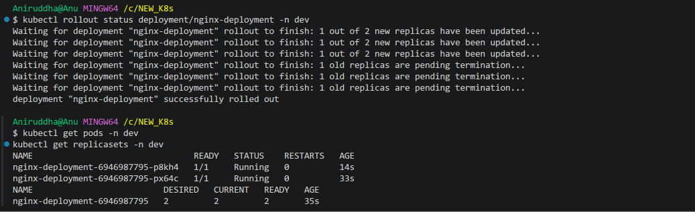

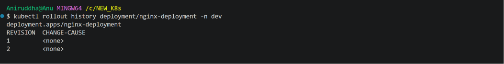

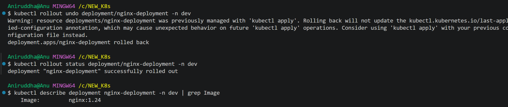

---

## Task 7 – Clean Up

After completing the practical exercises, I removed the resources created during this challenge.

Deleted the Deployment:

```bash
kubectl delete deployment nginx-deployment -n dev
```

Deleted the standalone Pods:

```bash
kubectl delete pod nginx-dev -n dev
kubectl delete pod nginx-staging -n staging
```

Deleted the custom namespaces:

```bash
kubectl delete namespace dev staging production
```

### Verify Cleanup

```bash
kubectl get namespaces
kubectl get pods -A
kubectl get deployments -A
kubectl get replicasets -A
```

### Observation

The custom namespaces `dev`, `staging`, and `production` were successfully deleted.

The application Pods, Deployment, and its ReplicaSets were also removed.

The remaining Pods and Deployments belonged to Kubernetes system components and the KIND local-path storage provisioner.

**Important:** Deleting a namespace also deletes the resources inside it. Therefore, namespace deletion should be handled carefully, especially in production environments.

### Screenshot

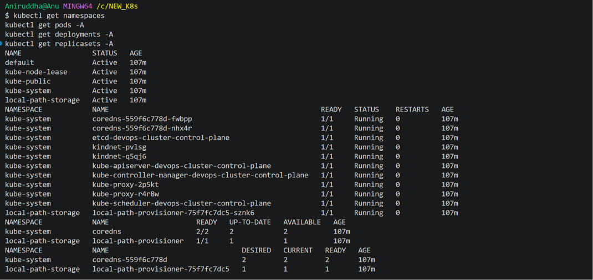

---

## Key Learnings

During Day 52, I learned:

1. What Kubernetes Namespaces are and how they organize resources.
2. The difference between default and custom namespaces.
3. How to create namespaces using imperative commands and YAML manifests.
4. How to create and manage Deployments.
5. The relationship between Deployments, ReplicaSets, and Pods.
6. How Deployment self-healing works when a Pod is deleted.
7. How to scale Deployments up and down.
8. The difference between imperative and declarative scaling.
9. How rolling updates work.
10. How to check rollout history and roll back to a previous version.
11. How to clean up Kubernetes resources and namespaces.

## Conclusion

Day 52 helped me understand how Kubernetes manages application workloads using Deployments and ReplicaSets.

I practiced creating custom namespaces, deploying multiple Nginx replicas, testing self-healing, scaling applications, performing rolling updates, and rolling back to a previous version.

This practical exercise helped me understand how Kubernetes maintains the desired state of applications.

**Day 52 – Completed!**

#90DaysOfDevOps #DevOpsKaJosh #TrainWithShubham