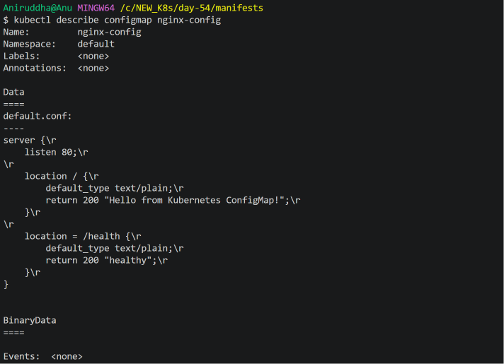
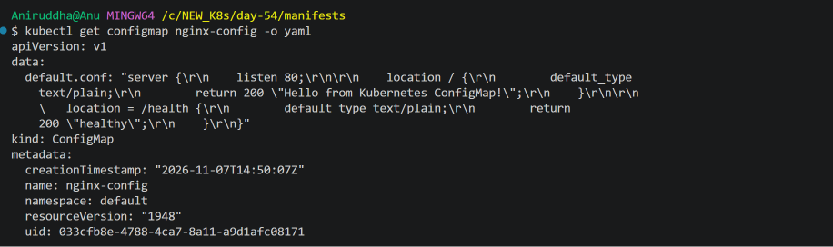
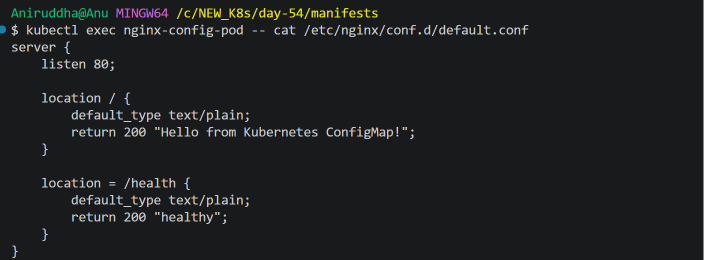
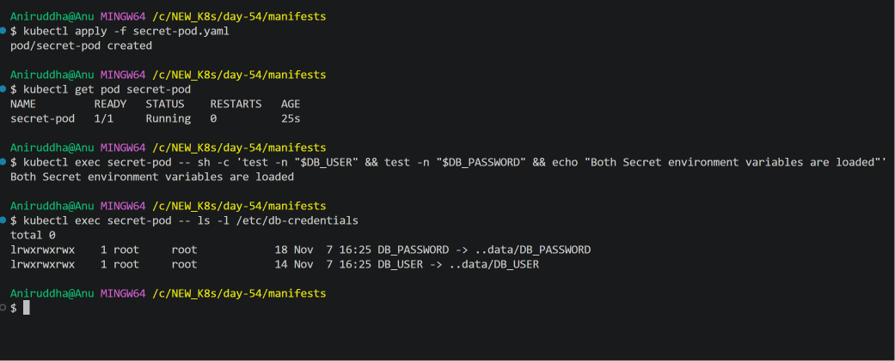
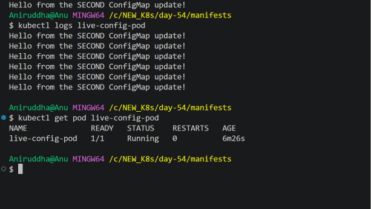
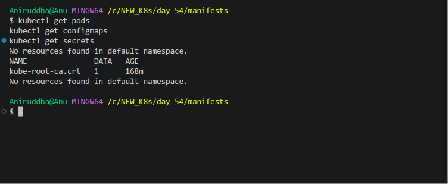

# Day 54 - Kubernetes ConfigMaps and Secrets

## Overview

On Day 54 of the 90 Days of DevOps challenge, I explored Kubernetes ConfigMaps and Secrets and learned how to manage application configuration and sensitive information inside Kubernetes Pods.

The main objective was to understand how configuration data and credentials can be stored separately from container images and consumed by applications running inside Kubernetes.

### Topics Covered

- Creating ConfigMaps using literal values.
- Creating ConfigMaps from configuration files.
- Injecting ConfigMap values into containers as environment variables.
- Mounting ConfigMaps as volumes.
- Creating Kubernetes Secrets.
- Understanding Base64 encoding in Kubernetes Secrets.
- Consuming Secrets through environment variables and volume mounts.
- Observing live ConfigMap updates without restarting Pods.
- Cleaning up Kubernetes resources.

## Environment

| Component | Version / Details |
|---|---|
| Operating System | Windows 11 |
| Terminal | VS Code Git Bash |
| Container Runtime | Docker Desktop |
| Kubernetes Tool | kubectl v1.36.1 |
| Kubernetes Cluster | KIND |
| Kubernetes Version | v1.37.0 |
| Cluster Name | devops-cluster |

## 1. Creating a ConfigMap Using Literal Values

A ConfigMap is a Kubernetes object used to store non-sensitive configuration data as key-value pairs.

Instead of hardcoding configuration values inside container images or application code, we can store them in ConfigMaps and inject them into Pods when required.

### Create a ConfigMap

I created a ConfigMap named `app-config` using three literal values.

```bash
kubectl create configmap app-config \
  --from-literal=APP_ENV=production \
  --from-literal=APP_DEBUG=false \
  --from-literal=APP_PORT=8080
```

### Verify the ConfigMap

```bash
kubectl get configmaps
```

```bash
kubectl describe configmap app-config
```

To inspect the complete YAML representation:

```bash
kubectl get configmap app-config -o yaml
```

The ConfigMap contains the following key-value pairs:

| Key | Value |
|---|---|
| APP_ENV | production |
| APP_DEBUG | false |
| APP_PORT | 8080 |

**Important:** ConfigMap data values are stored as strings, including values that look like Boolean or numeric values.

### Screenshot



## 2. Creating a ConfigMap From a File

ConfigMaps can also be created using existing configuration files.

This approach is useful when applications require configuration files rather than individual environment variables.

For this task, I created an Nginx configuration file.

**File:** `config/default.conf`

```nginx
server {
    listen 80;

    location / {
        default_type text/plain;
        return 200 "Hello from Kubernetes ConfigMap!";
    }

    location = /health {
        default_type text/plain;
        return 200 "healthy";
    }
}
```

### Create the ConfigMap From the File

```bash
kubectl create configmap nginx-config \
  --from-file=default.conf=day-54/config/default.conf
```

### Verify the ConfigMap

```bash
kubectl get configmap nginx-config
```

```bash
kubectl describe configmap nginx-config
```

```bash
kubectl get configmap nginx-config -o yaml
```

The filename `default.conf` becomes the ConfigMap key, and its contents become the corresponding value.

### Screenshot



## 3. Consuming ConfigMaps Inside Pods

Kubernetes allows applications to consume ConfigMap data in multiple ways.

In this task, I explored two methods:

1. Environment variables.
2. Volume mounts.

### 3.1 Consuming ConfigMap Through Environment Variables

I created a BusyBox Pod using the manifest:

`manifests/config-env-pod.yml`

The Pod consumes three values from the previously created `app-config` ConfigMap.

The important configuration is:

```yaml
env:
  - name: APP_ENV
    valueFrom:
      configMapKeyRef:
        name: app-config
        key: APP_ENV

  - name: APP_DEBUG
    valueFrom:
      configMapKeyRef:
        name: app-config
        key: APP_DEBUG

  - name: APP_PORT
    valueFrom:
      configMapKeyRef:
        name: app-config
        key: APP_PORT
```

Apply the manifest:

```bash
kubectl apply -f config-env-pod.yml
```

Verify the Pod:

```bash
kubectl get pods
```

Check the environment variables inside the container:

```bash
kubectl exec config-env-pod -- printenv APP_ENV
kubectl exec config-env-pod -- printenv APP_DEBUG
kubectl exec config-env-pod -- printenv APP_PORT
```

The expected values are:

```text
APP_ENV=production
APP_DEBUG=false
APP_PORT=8080
```

I also verified the output using:

```bash
kubectl logs config-env-pod
```

**Important:** Environment variables populated from a ConfigMap are not automatically updated when the ConfigMap changes. The container must be restarted to receive the new values.

### Screenshot



### 3.2 Consuming ConfigMap Through Volume Mounts

In this task, I mounted the `nginx-config` ConfigMap inside an Nginx container.

Manifest:

`manifests/nginx-config-pod.yaml`

The important configuration is:

```yaml
volumeMounts:
  - name: nginx-config-volume
    mountPath: /etc/nginx/conf.d
    readOnly: true

volumes:
  - name: nginx-config-volume
    configMap:
      name: nginx-config
```

Apply the manifest:

```bash
kubectl apply -f nginx-config-pod.yaml
```

Verify the Pod:

```bash
kubectl get pods
```

Inspect the mounted configuration file:

```bash
kubectl exec nginx-config-pod -- cat /etc/nginx/conf.d/default.conf
```

Test the Nginx health endpoint:

```bash
kubectl exec nginx-config-pod -- curl -s http://localhost/health
```

Expected output:

```text
healthy
```

**How the volume mounting works:**

- `nginx-config` is the existing ConfigMap.
- `nginx-config-volume` is the volume name defined inside the Pod.
- `volumeMounts` connects that volume to the container.
- `/etc/nginx/conf.d` is the mount location inside the container.
- The ConfigMap key `default.conf` appears as a file at the mount location.

### Screenshot


## 4. Creating a Kubernetes Secret

A Kubernetes Secret is used to store sensitive information such as:

- Database usernames and passwords.
- API tokens.
- Authentication credentials.
- TLS certificates and private keys.

Unlike ConfigMaps, Secrets are intended for sensitive data.

For this task, I created a generic Secret named `db-secret`.

### Create the Secret

```bash
kubectl create secret generic db-secret \
  --from-literal=DB_USER=<database-username> \
  --from-literal=DB_PASSWORD='<database-password>'
```

The actual lab password was supplied directly in the terminal and is intentionally not included in this documentation.

### Verify the Secret

```bash
kubectl get secrets
```

```bash
kubectl describe secret db-secret
```

The Secret was created with:

```text
NAME        TYPE     DATA
db-secret   Opaque   2
```

`Opaque` is the default Secret type for arbitrary user-defined key-value data.

### Inspect the Secret YAML

```bash
kubectl get secret db-secret -o yaml
```

Kubernetes displays Secret data using Base64 encoding.

For example, the lab username `admin` is represented as:

```text
YWRtaW4=
```

It can be decoded using:

```bash
echo -n 'YWRtaW4=' | base64 --decode
```

Expected output:

```text
admin
```

### Important Security Note

Base64 is an encoding mechanism, not encryption.

Anyone with sufficient access to read a Kubernetes Secret can decode its Base64 values.

For production environments, additional security measures are important:

- Enable encryption at rest for Secrets in etcd.
- Apply restrictive Role-Based Access Control (RBAC).
- Avoid committing credentials to Git repositories.
- Use external secret-management solutions where appropriate.
- Follow the principle of least privilege.

### Screenshot


## 5. Consuming Secrets Inside Pods

Kubernetes Secrets can be consumed through environment variables and volume mounts, similar to ConfigMaps.

For this task, I created a BusyBox Pod using:

`manifests/secret-pod.yaml`

The Pod consumes the `db-secret` Secret using both methods.

### 5.1 Consuming Secret Through Environment Variables

The important configuration is:

```yaml
env:
  - name: DB_USER
    valueFrom:
      secretKeyRef:
        name: db-secret
        key: DB_USER

  - name: DB_PASSWORD
    valueFrom:
      secretKeyRef:
        name: db-secret
        key: DB_PASSWORD
```

Apply the manifest:

```bash
kubectl apply -f secret-pod.yaml
```

Verify the Pod:

```bash
kubectl get pods
```

Instead of printing the actual credentials, I verified that both environment variables were loaded:

```bash
kubectl exec secret-pod -- sh -c 'test -n "$DB_USER" && test -n "$DB_PASSWORD" && echo "Both Secret environment variables are loaded"'
```

Expected output:

```text
Both Secret environment variables are loaded
```

### 5.2 Consuming Secret Through Volume Mounts

The same Secret was mounted as a volume inside the container.

The important configuration is:

```yaml
volumeMounts:
  - name: db-secret-volume
    mountPath: /etc/db-credentials
    readOnly: true

volumes:
  - name: db-secret-volume
    secret:
      secretName: db-secret
```

Inspect the mounted files:

```bash
kubectl exec secret-pod -- ls -l /etc/db-credentials
```

The output showed:

```text
DB_PASSWORD -> ..data/DB_PASSWORD
DB_USER -> ..data/DB_USER
```

Kubernetes uses this directory structure to manage projected Secret volume data.

The credentials are available as files inside the container.

### Screenshot



## 6. Live ConfigMap Updates

This was one of the most important practical tasks of the day.

The objective was to understand whether an existing Pod can receive updated ConfigMap values without being deleted and recreated.

For this experiment, I created a ConfigMap named `live-config`.

### Step 1: Create the Initial ConfigMap

```bash
kubectl create configmap live-config \
  --from-literal=message="Hello from the original ConfigMap"
```

Verify it:

```bash
kubectl get configmap live-config -o yaml
```

### Step 2: Create a Pod That Reads the Mounted File

Manifest:

`manifests/live-config-pod.yml`

```yaml
apiVersion: v1
kind: Pod
metadata:
  name: live-config-pod
spec:
  containers:
    - name: busybox
      image: busybox:latest
      command:
        - sh
        - -c
        - "while true; do echo \"$(cat /etc/live-config/message)\"; sleep 5; done"
      volumeMounts:
        - name: live-config-volume
          mountPath: /etc/live-config
          readOnly: true
  volumes:
    - name: live-config-volume
      configMap:
        name: live-config
```

Apply the manifest:

```bash
kubectl apply -f live-config-pod.yml
```

Verify the Pod:

```bash
kubectl get pods
```

Inspect the mounted file:

```bash
kubectl exec live-config-pod -- cat /etc/live-config/message
```

Check the container logs:

```bash
kubectl logs live-config-pod
```

The original message appeared repeatedly:

```text
Hello from the original ConfigMap
Hello from the original ConfigMap
Hello from the original ConfigMap
```

### Step 3: Update the ConfigMap

I updated the existing ConfigMap with a new message using a client-side dry-run followed by `kubectl apply`.

```bash
kubectl create configmap live-config \
  --from-literal=message="Hello from the UPDATED ConfigMap" \
  --dry-run=client -o yaml | kubectl apply -f -
```

After waiting for the projected volume to refresh, I checked the mounted file:

```bash
kubectl exec live-config-pod -- cat /etc/live-config/message
```

Expected output:

```text
Hello from the UPDATED ConfigMap
```

Then I checked the logs:

```bash
kubectl logs live-config-pod
```

The updated message appeared in subsequent log entries.

### Step 4: Perform a Second ConfigMap Update

To verify the behaviour again, I updated the ConfigMap with another message.

```bash
kubectl create configmap live-config \
  --from-literal=message="Hello from the SECOND ConfigMap update!" \
  --dry-run=client -o yaml | kubectl apply -f -
```

I verified the mounted file:

```bash
kubectl exec live-config-pod -- cat /etc/live-config/message
```

Output:

```text
Hello from the SECOND ConfigMap update!
```

Then I checked the logs:

```bash
kubectl logs live-config-pod
```

The logs showed both the earlier updated message and the second updated message. Subsequent log entries contained:

```text
Hello from the SECOND ConfigMap update!
Hello from the SECOND ConfigMap update!
Hello from the SECOND ConfigMap update!
```

Finally, I verified the Pod status:

```bash
kubectl get pod live-config-pod
```

Output:

```text
NAME              READY   STATUS    RESTARTS   AGE
live-config-pod   1/1     Running   0          ...
```

The Pod remained running with zero restarts throughout the update experiment.

### Important Learning

When a ConfigMap is consumed through environment variables, updating the ConfigMap does not automatically change the environment variables inside an already-running container.

When a ConfigMap is mounted as a volume, Kubernetes eventually updates the projected files without requiring the Pod to be recreated.

However, the application must be able to reload or reread the updated files to use the new configuration.

**Note:** ConfigMap volume updates are eventually consistent, not instantaneous. Also, mounting a ConfigMap using `subPath` does not receive automatic updates.

### Screenshot



## 7. ConfigMap vs Secret

| Feature | ConfigMap | Secret |
|---|---|---|
| Purpose | Non-sensitive configuration | Sensitive information |
| Examples | Application settings, ports, feature flags | Passwords, tokens, certificates |
| Environment variables | Supported | Supported |
| Volume mounts | Supported | Supported |
| Default data representation | Plain text strings | Base64-encoded data |
| Automatic volume updates | Yes, eventually | Yes, eventually |

### Environment Variables vs Volume Mounts

| Consumption Method | Behaviour After Updating the Source |
|---|---|
| ConfigMap through environment variables | Container restart required |
| Secret through environment variables | Container restart required |
| ConfigMap through volume mount | Files update eventually |
| Secret through volume mount | Files update eventually |
| ConfigMap or Secret mounted using `subPath` | No automatic update |

**Production consideration:** Volume updates do not guarantee that an application automatically reloads its configuration. The application may need an explicit reload mechanism or restart.

## 8. Cleanup

After completing all experiments, I removed the resources created during Day 54.

### Delete the Pods

```bash
kubectl delete pod config-env-pod nginx-config-pod secret-pod live-config-pod
```

### Delete the ConfigMaps

```bash
kubectl delete configmap app-config nginx-config live-config
```

### Delete the Secret

```bash
kubectl delete secret db-secret
```

### Verify Cleanup

```bash
kubectl get pods
```

```bash
kubectl get configmaps
```

```bash
kubectl get secrets
```

The verification confirmed:

- No application Pods remained in the default namespace.
- The three ConfigMaps created during the lab were deleted.
- The `db-secret` Secret was deleted.
- The automatically maintained `kube-root-ca.crt` ConfigMap remained untouched.

### Screenshot



## 9. Key Learnings

After completing Day 54, I understood the following concepts:

1. ConfigMaps allow us to separate non-sensitive configuration from container images.
2. ConfigMaps can be created using literal values or existing configuration files.
3. ConfigMap values can be injected into containers through environment variables.
4. ConfigMaps can be mounted as volumes to provide configuration files inside containers.
5. Kubernetes Secrets are designed to store sensitive information.
6. Base64 encoding is not encryption.
7. Secrets can be consumed through environment variables and volume mounts.
8. Environment variables populated from ConfigMaps or Secrets do not automatically update in running containers.
9. Mounted ConfigMap and Secret volumes can receive updates without recreating Pods.
10. Applications must be capable of reloading updated configuration files to use new values.

## Conclusion

Day 54 helped me understand how Kubernetes manages application configuration and sensitive information through ConfigMaps and Secrets.

I also performed hands-on experiments to compare environment variables and volume mounts and verified how live ConfigMap updates work inside an existing Pod.

These concepts are important when deploying and managing real-world applications in Kubernetes environments.

**Day 54 completed successfully!**