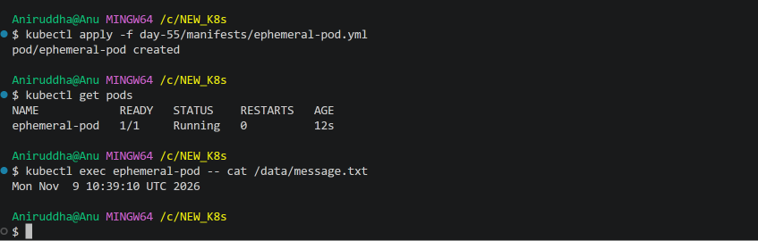
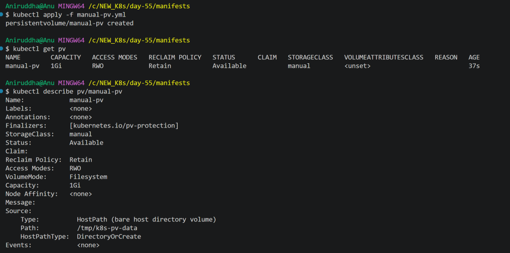
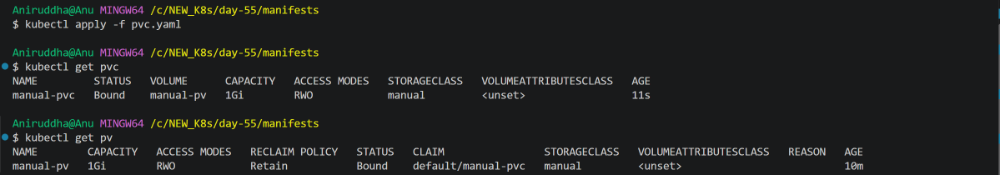
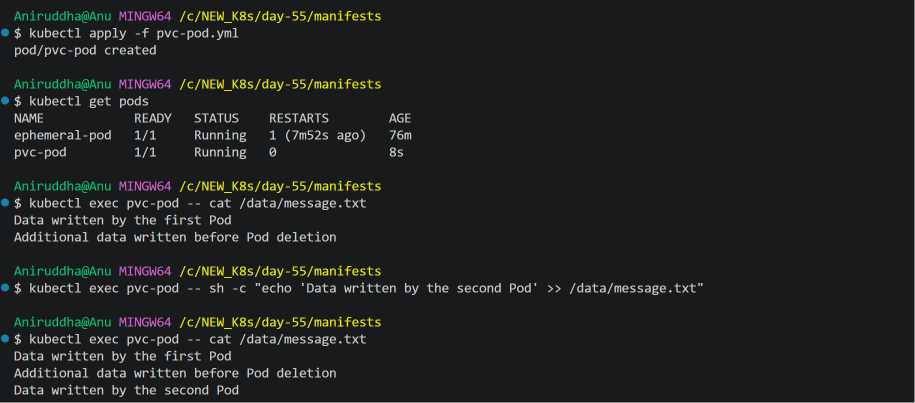
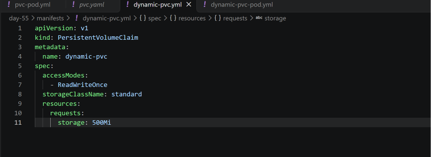
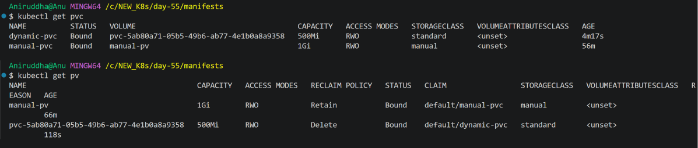
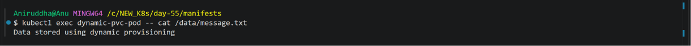
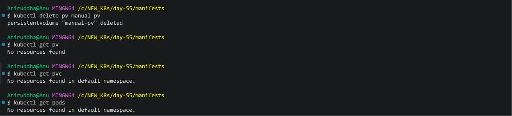

# Day 55 – Persistent Volumes (PV) and Persistent Volume Claims (PVC)

## Overview

Containers are ephemeral. When a Pod is deleted, data stored in its temporary container filesystem can disappear.

Kubernetes provides PersistentVolumes (PV) and PersistentVolumeClaims (PVC) to manage storage independently of Pod lifecycles.

In this challenge, I demonstrated data loss using `emptyDir`, created a static PersistentVolume, connected it to a PersistentVolumeClaim, verified data persistence across Pod deletion, and explored dynamic provisioning using StorageClasses.

## Environment

- Kubernetes: v1.37.0
- Cluster: KIND (`devops-cluster`)
- Nodes: 1 control-plane and 1 worker
- Container runtime: Docker Desktop / WSL2
- Working directory: `/c/NEW_K8s/day-55`

---

## Task 1: Demonstrate Data Loss Using emptyDir

### Objective

Demonstrate that data stored in an `emptyDir` volume does not survive Pod deletion and recreation.

### Pod Manifest

File: `manifests/ephemeral-pod.yml`

The Pod uses a BusyBox container and an `emptyDir` volume mounted at `/data`.

The container writes the current timestamp to `/data/message.txt` and sleeps for 3600 seconds.

### Create the Pod

```bash
kubectl apply -f ephemeral-pod.yml
kubectl get pods
```

### Verify the timestamp

```bash
kubectl exec ephemeral-pod -- cat /data/message.txt
```

Initial timestamp:

```text
Mon Nov 9 14:00:28 UTC 2026
```

### Delete and recreate the Pod

```bash
kubectl delete pod ephemeral-pod
kubectl get pods
kubectl apply -f ephemeral-pod.yml
kubectl get pods
```

After recreation, the new timestamp was:

```text
Mon Nov 9 14:08:18 UTC 2026
```

### Observation

The timestamps were different.

The original `emptyDir` volume was deleted along with the Pod. When Kubernetes created the new Pod, it created a fresh `emptyDir` volume.

This demonstrated that `emptyDir` data survives container restarts within the same Pod but does not survive Pod deletion.

### Screenshot



---

## Task 2: Create a PersistentVolume (Static Provisioning)

### Objective

Create a PersistentVolume manually using static provisioning.

### PV Configuration

| Property | Value |
|---|---|
| PV name | `manual-pv` |
| Capacity | `1Gi` |
| Access mode | `ReadWriteOnce` |
| Reclaim policy | `Retain` |
| StorageClass | `manual` |
| Volume type | `hostPath` |
| Host path | `/tmp/k8s-pv-data` |

### PV Manifest

File: `manifests/manual-pv.yml`

```yaml
apiVersion: v1
kind: PersistentVolume
metadata:
  name: manual-pv
spec:
  capacity:
    storage: 1Gi
  accessModes:
    - ReadWriteOnce
  persistentVolumeReclaimPolicy: Retain
  storageClassName: manual
  hostPath:
    path: /tmp/k8s-pv-data
    type: DirectoryOrCreate
```

### Apply the manifest

```bash
kubectl apply -f manual-pv.yml
```

Verify:

```bash
kubectl get pv
kubectl describe pv manual-pv
```

### Result

```text
NAME        CAPACITY   ACCESS MODES   RECLAIM POLICY   STATUS
manual-pv   1Gi        RWO            Retain           Available
```

The PV was successfully created with `Available` status because no PVC had claimed it yet.

### Access Modes

| Access Mode | Description |
|---|---|
| ReadWriteOnce (RWO) | Read-write mounting by a single node |
| ReadOnlyMany (ROX) | Read-only mounting by many nodes |
| ReadWriteMany (RWX) | Read-write mounting by many nodes |

Note: Access modes describe how storage can be mounted. ReadWriteOnce does not strictly mean that only one Pod can use the volume.

`hostPath` is useful for local learning environments but is not recommended as a general production storage solution.

### Screenshot



---

## Task 3: Create a PersistentVolumeClaim

### Objective

Request storage from the manually created PersistentVolume.

### PVC Configuration

| Property | Value |
|---|---|
| PVC name | `manual-pvc` |
| Requested storage | `500Mi` |
| Access mode | `ReadWriteOnce` |
| StorageClass | `manual` |

### PVC Manifest

File: `manifests/pvc.yaml`

```yaml
apiVersion: v1
kind: PersistentVolumeClaim
metadata:
  name: manual-pvc
spec:
  accessModes:
    - ReadWriteOnce
  storageClassName: manual
  resources:
    requests:
      storage: 500Mi
```

### Apply the manifest

```bash
kubectl apply -f pvc.yaml
```

Verify:

```bash
kubectl get pvc
kubectl get pv
kubectl describe pvc manual-pvc
```

### Result

PVC:

```text
NAME         STATUS   VOLUME      CAPACITY   ACCESS MODES   STORAGECLASS
manual-pvc   Bound    manual-pv   1Gi        RWO            manual
```

PV:

```text
NAME        CAPACITY   ACCESS MODES   RECLAIM POLICY   STATUS
manual-pv   1Gi        RWO            Retain           Bound
```

### Observation

The PVC requested `500Mi`, and Kubernetes matched it with the available `1Gi` PV.

The PVC's `VOLUME` column showed `manual-pv`.

The PVC reported `1Gi` capacity because that is the capacity of its bound PV.

Both resources successfully reached `Bound` status.

### Screenshot



---

## Task 4: Use the PVC in a Pod – Data Persistence

### Objective

Mount the PVC inside a Pod and verify that data survives Pod deletion and recreation.

### Pod Manifest

File: `manifests/pvc-pod.yml`

The Pod uses the `manual-pvc` claim and mounts it at `/data`.

```yaml
apiVersion: v1
kind: Pod
metadata:
  name: pvc-pod
spec:
  containers:
    - name: busybox
      image: busybox:latest
      command:
        - sh
        - -c
        - "echo 'Data written by the first Pod' > /data/message.txt && echo 'First Pod started' && sleep 3600"
      volumeMounts:
        - name: persistent-storage
          mountPath: /data
  volumes:
    - name: persistent-storage
      persistentVolumeClaim:
        claimName: manual-pvc
```

### Create the Pod

```bash
kubectl apply -f pvc-pod.yml
kubectl get pods
```

Verify the file:

```bash
kubectl exec pvc-pod -- cat /data/message.txt
```

Initial content:

```text
Data written by the first Pod
```

Append another message:

```bash
kubectl exec pvc-pod -- sh -c "echo 'Additional data written before Pod deletion' >> /data/message.txt"
```

Verify:

```bash
kubectl exec pvc-pod -- cat /data/message.txt
```

### Delete and recreate the Pod

Before recreating the Pod, the startup command was changed so that it would not overwrite the existing file.

The updated command:

```yaml
command:
  - sh
  - -c
  - "echo 'Second Pod started' && sleep 3600"
```

An initial YAML formatting mistake caused a `RunContainerError`. The `kubectl describe pod pvc-pod` output revealed that the entire command had been interpreted as one executable name.

After correcting the command, the existing Pod still rejected the change because Pod command fields are immutable.

The Pod was deleted and recreated using the corrected manifest:

```bash
kubectl delete pod pvc-pod
kubectl apply -f pvc-pod.yml
kubectl get pods
```

### Verify the original data

```bash
kubectl exec pvc-pod -- cat /data/message.txt
```

The recreated Pod could still read:

```text
Data written by the first Pod
Additional data written before Pod deletion
```

Then a third line was appended from the recreated Pod:

```bash
kubectl exec pvc-pod -- sh -c "echo 'Data written by the second Pod' >> /data/message.txt"
```

Final output:

```text
Data written by the first Pod
Additional data written before Pod deletion
Data written by the second Pod
```

### Observation

The original data survived Pod deletion and recreation because both Pods mounted the same PVC, which remained bound to the same PV.

The Pod lifecycle and storage lifecycle are independent.

### Screenshot



---

## Task 5: Explore StorageClasses

### Objective

Explore the StorageClass available in the KIND cluster and understand dynamic provisioning.

### Commands

```bash
kubectl get storageclass
kubectl describe storageclass
```

### StorageClass Output

```text
NAME                 PROVISIONER             RECLAIMPOLICY   VOLUMEBINDINGMODE
standard (default)   rancher.io/local-path   Delete          WaitForFirstConsumer
```

### StorageClass Details

| Property | Value |
|---|---|
| Name | `standard` |
| Default | Yes |
| Provisioner | `rancher.io/local-path` |
| Reclaim policy | `Delete` |
| Volume binding mode | `WaitForFirstConsumer` |
| Volume expansion | Disabled |

### Important Concepts

**Provisioner**

The provisioner is responsible for dynamically creating storage when a PVC requests it.

In this KIND cluster, the provisioner is `rancher.io/local-path`.

**Reclaim Policy**

The default StorageClass uses `Delete`. Dynamically provisioned storage is deleted when its PVC is deleted.

**WaitForFirstConsumer**

The PVC may remain Pending until a Pod uses it.

Kubernetes waits for a consuming Pod so that it can consider the Pod's scheduling requirements before provisioning and binding the storage.

### Screenshot



---

## Task 6: Dynamic Provisioning

### Objective

Create a PVC using the default StorageClass and allow Kubernetes to provision a PV automatically.

### Dynamic PVC Manifest

File: `manifests/dynamic-pvc.yml`

```yaml
apiVersion: v1
kind: PersistentVolumeClaim
metadata:
  name: dynamic-pvc
spec:
  accessModes:
    - ReadWriteOnce
  storageClassName: standard
  resources:
    requests:
      storage: 500Mi
```

### Apply the PVC

```bash
kubectl apply -f dynamic-pvc.yml
```

The PVC uses the `standard` StorageClass.

### Dynamic Pod Manifest

File: `manifests/dynamic-pvc-pod.yml`

```yaml
apiVersion: v1
kind: Pod
metadata:
  name: dynamic-pvc-pod
spec:
  containers:
    - name: busybox
      image: busybox:latest
      command:
        - sh
        - -c
        - "echo 'Data stored using dynamic provisioning' > /data/message.txt && echo 'Dynamic storage is working' && sleep 3600"
      volumeMounts:
        - name: dynamic-storage
          mountPath: /data
  volumes:
    - name: dynamic-storage
      persistentVolumeClaim:
        claimName: dynamic-pvc
```

### Create the Pod

```bash
kubectl apply -f dynamic-pvc-pod.yml
kubectl get pods
```

### Verify PVC and PV

```bash
kubectl get pvc
kubectl get pv
```

PVC output:

```text
NAME          STATUS   VOLUME                                     CAPACITY   ACCESS MODES   STORAGECLASS
dynamic-pvc   Bound    pvc-5ab80a71-05b5-49b6-ab77-4e1b0a8a9358   500Mi      RWO            standard
manual-pvc    Bound    manual-pv                                  1Gi        RWO            manual
```

PV output:

```text
NAME                                       CAPACITY   ACCESS MODES   RECLAIM POLICY   STATUS
manual-pv                                  1Gi        RWO            Retain           Bound
pvc-5ab80a71-05b5-49b6-ab77-4e1b0a8a9358   500Mi      RWO            Delete           Bound
```

### Verify the data

```bash
kubectl exec dynamic-pvc-pod -- cat /data/message.txt
```

Output:

```text
Data stored using dynamic provisioning
```

### Static vs Dynamic Provisioning

| Property | Static Provisioning | Dynamic Provisioning |
|---|---|---|
| PV creation | Manually created | Automatically created |
| Storage request | PVC | PVC |
| StorageClass | `manual` | `standard` |
| PV name | `manual-pv` | Automatically generated |
| Capacity | 1Gi | 500Mi |
| Reclaim policy | Retain | Delete |

### Observation

Two PVs existed during this task:

1. `manual-pv` – manually created.
2. `pvc-5ab80a71-05b5-49b6-ab77-4e1b0a8a9358` – automatically provisioned by the local-path provisioner.

Dynamic provisioning eliminates the need to manually create a PV for every storage request.

### Screenshots





---

## Task 7: Cleanup

### Objective

Delete all Pods and PVCs, observe the PV reclaim policies, and remove the remaining PV.

### Step 1: Delete all Pods

```bash
kubectl delete pod ephemeral-pod pvc-pod dynamic-pvc-pod
```

Verify:

```bash
kubectl get pods
```

### Step 2: Delete PVCs

```bash
kubectl delete pvc manual-pvc dynamic-pvc
```

Verify:

```bash
kubectl get pvc
kubectl get pv
```

### Observed PV Result

```text
NAME        CAPACITY   ACCESS MODES   RECLAIM POLICY   STATUS
manual-pv   1Gi        RWO            Retain           Released
```

The dynamically provisioned PV was automatically deleted because its reclaim policy was `Delete`.

The manually created PV remained in `Released` status because its reclaim policy was `Retain`.

### Step 3: Delete the remaining PV

```bash
kubectl delete pv manual-pv
```

### Final Verification

```bash
kubectl get pv
kubectl get pvc
kubectl get pods
```

All three commands returned no resources.

### Reclaim Policy Comparison

| Reclaim Policy | Behavior |
|---|---|
| Retain | Keeps the underlying storage after PVC deletion; PV becomes Released |
| Delete | Deletes the PV and its provisioned storage when the PVC is deleted |

### Observation

The manual PV was retained until manually deleted.

The dynamic PV was automatically deleted by its provisioner's Delete reclaim policy.

This demonstrated the practical difference between `Retain` and `Delete`.

### Screenshot



---

## Key Learnings

1. Containers are ephemeral, and data stored only in their writable filesystem can be lost.
2. `emptyDir` survives container restarts within the same Pod but is deleted when the Pod is deleted.
3. PersistentVolumes are cluster-wide storage resources.
4. PersistentVolumeClaims are namespaced requests for storage.
5. Kubernetes binds PVCs to suitable PVs based on storage requirements and matching properties.
6. Static provisioning requires an administrator to create the PV manually.
7. Dynamic provisioning uses a StorageClass and provisioner to create PVs automatically.
8. `ReadWriteOnce`, `ReadOnlyMany`, and `ReadWriteMany` describe volume access modes.
9. `Retain` preserves storage after PVC deletion, while `Delete` removes dynamically provisioned storage.
10. `WaitForFirstConsumer` delays provisioning and binding until a Pod consumes the PVC.

## Conclusion

Completed Day 55 of the 90 Days of DevOps challenge.

Demonstrated ephemeral storage data loss, created and bound a static PV and PVC, verified persistence across Pod deletion and recreation, explored StorageClasses, and successfully tested dynamic provisioning using KIND.

Also verified the difference between `Retain` and `Delete` reclaim policies through the cleanup process.

**Day 55 – Persistent Volumes and Persistent Volume Claims: Completed.**

---

## Learn in Public

Learned Kubernetes Persistent Volumes and PVCs today. Proved container data is ephemeral, then fixed it with PVs. Also explored dynamic provisioning with StorageClasses.

#90DaysOfDevOps #DevOpsKaJosh #TrainWithShubham