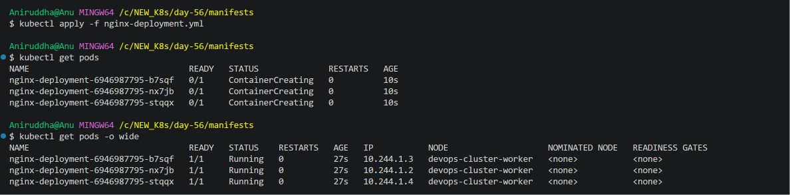
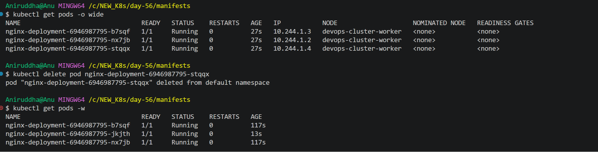
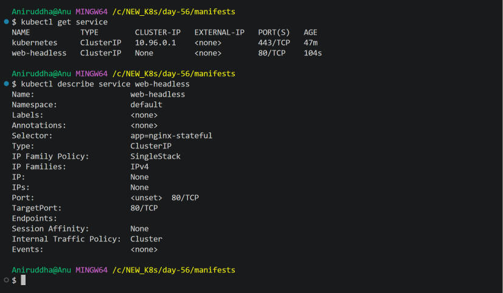
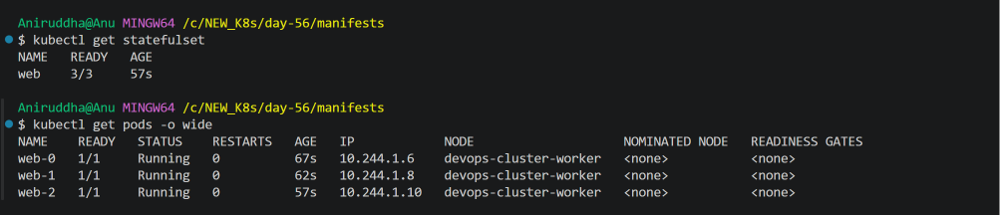
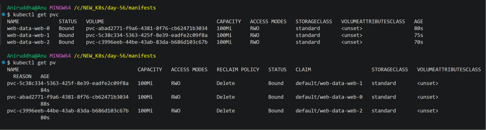
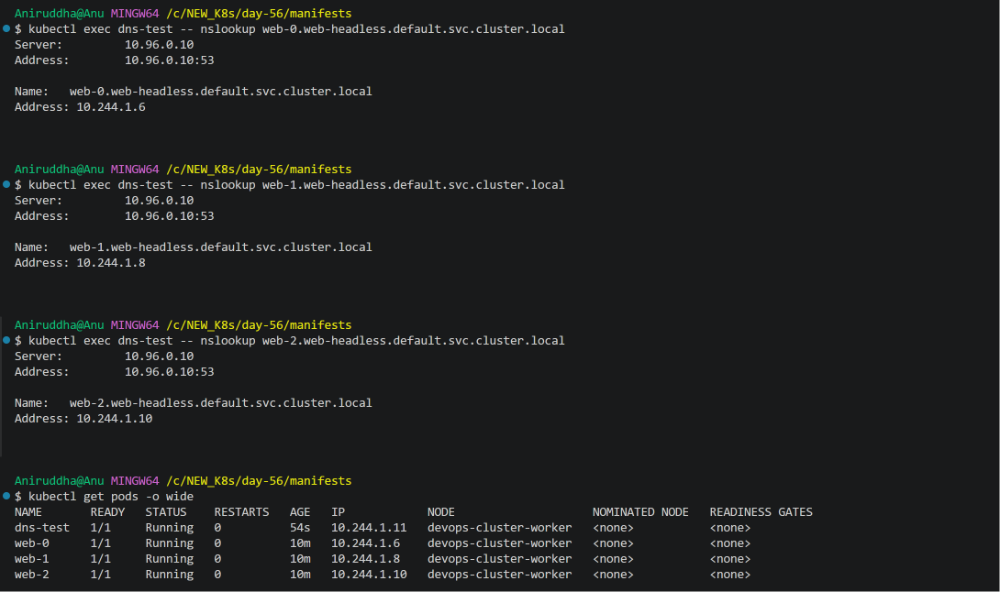
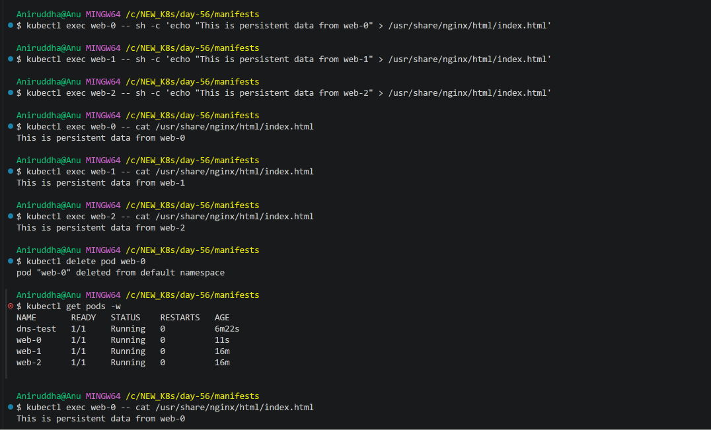
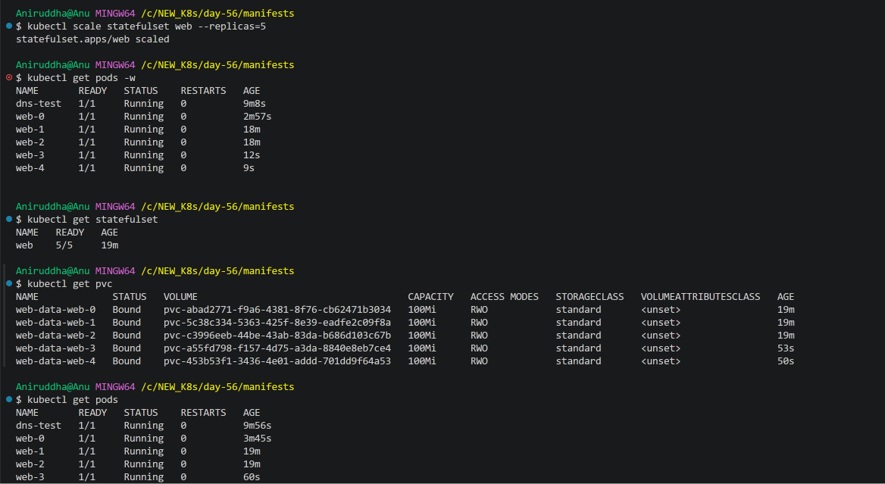
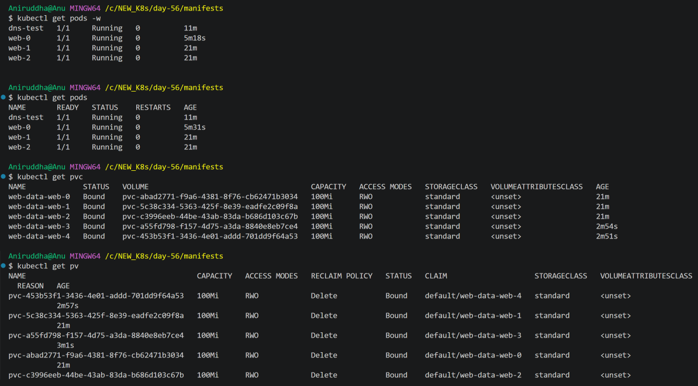
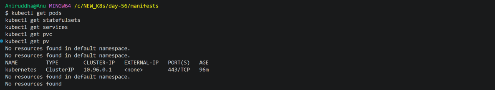

# Day 56 – Kubernetes StatefulSets

## Overview

On Day 56 of the 90 Days of DevOps challenge, I explored Kubernetes StatefulSets and learned how they differ from Deployments.

The hands-on exercises covered:

- Understanding the limitations of Deployments for stateful applications.
- Creating a Headless Service.
- Deploying applications using StatefulSets.
- Dynamic PersistentVolume and PersistentVolumeClaim provisioning.
- Stable network identities and DNS discovery.
- Persistent data across Pod deletion and recreation.
- Ordered scaling of StatefulSets.
- Cleaning up Kubernetes resources.

## Environment

| Component | Version / Configuration |
|---|---|
| Operating System | Windows 11 |
| Terminal | Git Bash |
| Kubernetes distribution | KIND |
| Cluster | devops-cluster |
| Kubernetes context | kind-devops-cluster |
| Kubernetes version | v1.37.0 |
| Nodes | 1 Control Plane + 1 Worker |
| Container Runtime | Docker Desktop |
| StorageClass | standard |
| Storage Provisioner | rancher.io/local-path |

---

## Task 1 – Understanding Deployment Pod Identity

First, I created a Deployment with three Nginx replicas.

### Deployment Manifest

File: `manifests/nginx-deployment.yml`

```yaml
apiVersion: apps/v1
kind: Deployment
metadata:
  name: nginx-deployment
  labels:
    app: nginx
spec:
  replicas: 3
  selector:
    matchLabels:
      app: nginx
  template:
    metadata:
      labels:
        app: nginx
    spec:
      containers:
        - name: nginx
          image: nginx:1.25
          ports:
            - containerPort: 80
```

Apply the manifest:

```bash
kubectl apply -f manifests/nginx-deployment.yml
```

Verify the Pods:

```bash
kubectl get pods -o wide
```

Kubernetes created three Pods with randomly generated names.



### Test Deployment Self-Healing

I deleted one of the Pods:

```bash
kubectl delete pod nginx-deployment-6946987795-stqqx
```

Watched the Pods:

```bash
kubectl get pods -w
```

Kubernetes automatically created a replacement Pod with a different generated name.



### Observation

A Deployment maintains the desired number of replicas, but individual Pod names are not stable.

For stateful applications such as database clusters, stable identities are important because cluster members may need predictable names to discover and communicate with each other.

StatefulSets provide stable Pod identities, unlike ordinary Deployment replicas.

Delete the Deployment:

```bash
kubectl delete deployment nginx-deployment
```

Verify cleanup:

```bash
kubectl get deployments
kubectl get pods
```

---

## Task 2 – Create a Headless Service

A Headless Service does not allocate a virtual ClusterIP.

Instead, it allows DNS to return the IP addresses of individual Pods selected by the Service.

### Headless Service Manifest

File: `manifests/headless-service.yml`

```yaml
apiVersion: v1
kind: Service
metadata:
  name: web-headless
spec:
  clusterIP: None
  selector:
    app: nginx-stateful
  ports:
    - port: 80
      targetPort: 80
```

Apply the manifest:

```bash
kubectl apply -f manifests/headless-service.yml
```

Verify the Service:

```bash
kubectl get services
kubectl describe service web-headless
```

The Service showed:

```text
NAME           TYPE        CLUSTER-IP   EXTERNAL-IP   PORT(S)
web-headless   ClusterIP   None         <none>        80/TCP
```



### Important Concepts

- `clusterIP: None` configures the Service as headless.
- `selector` identifies the Pods that belong to the Service.
- `port` defines the Service port.
- `targetPort` identifies the container port receiving traffic.

The Endpoints field was initially empty because the StatefulSet Pods had not yet been created.

---

## Task 3 – Create a StatefulSet

Next, I created a StatefulSet with three Nginx replicas.

Unlike Deployments, StatefulSets assign stable ordinal names to Pods.

The expected Pod names were:

```text
web-0
web-1
web-2
```

### StatefulSet Manifest

File: `manifests/web-statefulset.yml`

```yaml
apiVersion: apps/v1
kind: StatefulSet
metadata:
  name: web
spec:
  serviceName: web-headless
  replicas: 3
  selector:
    matchLabels:
      app: nginx-stateful
  template:
    metadata:
      labels:
        app: nginx-stateful
    spec:
      containers:
        - name: nginx
          image: nginx:1.25
          ports:
            - containerPort: 80
          volumeMounts:
            - name: web-data
              mountPath: /usr/share/nginx/html
  volumeClaimTemplates:
    - metadata:
        name: web-data
      spec:
        accessModes:
          - ReadWriteOnce
        storageClassName: standard
        resources:
          requests:
            storage: 100Mi
```

Apply the StatefulSet:

```bash
kubectl apply -f manifests/web-statefulset.yml
```

Watch Pod creation:

```bash
kubectl get pods -w
```

The Pods were created in order:

```text
web-0
web-1
web-2
```

Verify the StatefulSet:

```bash
kubectl get statefulset
kubectl get pods -o wide
```

The StatefulSet reached `3/3 READY`.



### Dynamic Persistent Storage Provisioning

The StatefulSet used `volumeClaimTemplates` to automatically create a separate PVC for every Pod.

Because the `standard` StorageClass was specified, the local-path provisioner dynamically created the corresponding PersistentVolumes.

Verify the PVCs:

```bash
kubectl get pvc
```

Verify the PVs:

```bash
kubectl get pv
```

The resulting PVCs were:

```text
web-data-web-0
web-data-web-1
web-data-web-2
```

Each PVC requested 100Mi of storage and reached the Bound state.



### Important Concepts

- `serviceName` associates the StatefulSet with the Headless Service.
- `replicas` specifies the desired number of Pods.
- `volumeClaimTemplates` automatically creates individual PVCs.
- Each Pod receives its own persistent storage claim.
- The StorageClass dynamically provisions the corresponding PV.

No separate PV or PVC manifests were required for this dynamic provisioning workflow.

---

## Task 4 – Verify Individual Pod DNS

Next, I tested DNS-based discovery of individual StatefulSet Pods.

Created a temporary BusyBox Pod:

```bash
kubectl run dns-test --image=busybox:latest --restart=Never --command -- sleep 3600
```

Verified the Pod:

```bash
kubectl get pod dns-test
```

### StatefulSet Pod DNS Format

The DNS naming format is:

```text
<pod-name>.<headless-service>.<namespace>.svc.cluster.local
```

For this StatefulSet:

| Pod | DNS Name |
|---|---|
| web-0 | web-0.web-headless.default.svc.cluster.local |
| web-1 | web-1.web-headless.default.svc.cluster.local |
| web-2 | web-2.web-headless.default.svc.cluster.local |

### DNS Lookup

Resolve the first Pod:

```bash
kubectl exec dns-test -- nslookup web-0.web-headless.default.svc.cluster.local
```

Resolve the second Pod:

```bash
kubectl exec dns-test -- nslookup web-1.web-headless.default.svc.cluster.local
```

Resolve the third Pod:

```bash
kubectl exec dns-test -- nslookup web-2.web-headless.default.svc.cluster.local
```

Verify the Pod IP addresses:

```bash
kubectl get pods -o wide
```

The DNS results matched the individual Pod IP addresses:

| Pod | DNS Resolved IP |
|---|---|
| web-0 | 10.244.1.6 |
| web-1 | 10.244.1.8 |
| web-2 | 10.244.1.10 |



### Observation

The Headless Service allows DNS to resolve individual StatefulSet Pod names to their respective Pod IP addresses.

This is useful for applications that require stable network identities, such as distributed databases and clustered applications.

---

## Task 5 – Verify Persistent Data Across Pod Deletion

In this task, I verified whether data stored in a StatefulSet Pod survives its deletion and recreation.

Each Pod had its own PVC mounted at:

```text
/usr/share/nginx/html
```

### Write Unique Data to Each Pod

For `web-0`:

```bash
kubectl exec web-0 -- sh -c 'echo "This is persistent data from web-0" > /usr/share/nginx/html/index.html'
```

For `web-1`:

```bash
kubectl exec web-1 -- sh -c 'echo "This is persistent data from web-1" > /usr/share/nginx/html/index.html'
```

For `web-2`:

```bash
kubectl exec web-2 -- sh -c 'echo "This is persistent data from web-2" > /usr/share/nginx/html/index.html'
```

### Verify the Data

```bash
kubectl exec web-0 -- cat /usr/share/nginx/html/index.html
kubectl exec web-1 -- cat /usr/share/nginx/html/index.html
kubectl exec web-2 -- cat /usr/share/nginx/html/index.html
```

All three Pods displayed their respective messages.

### Delete web-0

```bash
kubectl delete pod web-0
```

Watch the replacement:

```bash
kubectl get pods -w
```

Kubernetes recreated the Pod with the same name:

```text
web-0
```

### Verify Persistent Data

```bash
kubectl exec web-0 -- cat /usr/share/nginx/html/index.html
```

Output:

```text
This is persistent data from web-0
```

The data was still available after Pod recreation.



### Observation

The StatefulSet recreated `web-0` and reattached its existing PVC, `web-data-web-0`.

The Pod was replaced, but its persistent storage remained available.

This demonstrates why StatefulSets are useful for applications that require stable identities and persistent storage.

---

## Task 6 – StatefulSet Scaling

In this task, I tested ordered scaling and PVC retention.

### Scale Up: 3 to 5 Replicas

Execute:

```bash
kubectl scale statefulset web --replicas=5
```

Watch the Pods:

```bash
kubectl get pods -w
```

Kubernetes created two additional Pods:

```text
web-3
web-4
```

Verify:

```bash
kubectl get statefulset
kubectl get pods
kubectl get pvc
```

The StatefulSet reached `5/5 READY`.

Two additional PVCs were automatically created:

```text
web-data-web-3
web-data-web-4
```

All five PVCs reached the Bound state.



### Scale Down: 5 to 3 Replicas

Execute:

```bash
kubectl scale statefulset web --replicas=3
```

Watch the Pods:

```bash
kubectl get pods -w
```

StatefulSet removed the higher ordinal Pods first:

```text
web-4
web-3
```

Verify the remaining Pods:

```bash
kubectl get pods
```

Only the following Pods remained:

```text
web-0
web-1
web-2
```

### Verify PVC Retention

```bash
kubectl get pvc
kubectl get pv
```

Even after scaling down, all five PVCs remained:

```text
web-data-web-0
web-data-web-1
web-data-web-2
web-data-web-3
web-data-web-4
```

Their associated PVs also remained Bound.



### Observation

StatefulSets use ordered scaling by default.

- During scale-up, higher ordinal Pods are created sequentially.
- During scale-down, higher ordinal Pods are removed first.
- Scaling down does not automatically delete the PVCs associated with removed Pods.

Retaining PVCs protects the data associated with those StatefulSet replicas.

---

## Task 7 – Cleanup

Finally, I removed all resources created during Day 56.

### Delete Temporary DNS Pod

```bash
kubectl delete pod dns-test
```

### Delete StatefulSet

```bash
kubectl delete statefulset web
```

### Delete Headless Service

```bash
kubectl delete service web-headless
```

### Verify PVCs

```bash
kubectl get pvc
```

The PVCs remained after StatefulSet deletion, so I deleted them explicitly.

### Delete All PVCs

```bash
kubectl delete pvc web-data-web-0 web-data-web-1 web-data-web-2 web-data-web-3 web-data-web-4
```

The dynamically provisioned PVs were deleted automatically because the StorageClass used the `Delete` reclaim policy.

### Final Verification

```bash
kubectl get pods
kubectl get statefulsets
kubectl get services
kubectl get pvc
kubectl get pv
```

Final verification confirmed:

- No application Pods remained.
- No StatefulSets remained.
- The Headless Service was deleted.
- All five PVCs were deleted.
- All dynamically provisioned PVs were deleted.
- The default Kubernetes Service remained.



---

## Key Learnings

Through this hands-on exercise, I learned:

1. Deployments create interchangeable Pods with generated names.
2. StatefulSets provide stable and predictable Pod identities.
3. Headless Services enable individual Pod DNS discovery.
4. StatefulSets create Pods in an ordered manner by default.
5. `volumeClaimTemplates` automatically creates individual PVCs.
6. StorageClasses and provisioners support dynamic PV provisioning.
7. StatefulSet Pods can retain their persistent data after deletion and recreation.
8. StatefulSets use ordered scaling by default.
9. Scaling down does not automatically delete associated PVCs.
10. StatefulSet deletion and PVC deletion are separate operations.

## Conclusion

Day 56 helped me understand how Kubernetes StatefulSets manage applications that require stable network identities and persistent storage.

I also gained practical experience with Headless Services, DNS discovery, dynamic storage provisioning, data persistence, ordered scaling, and resource cleanup.

**Day 56 – Kubernetes StatefulSets: Completed.**