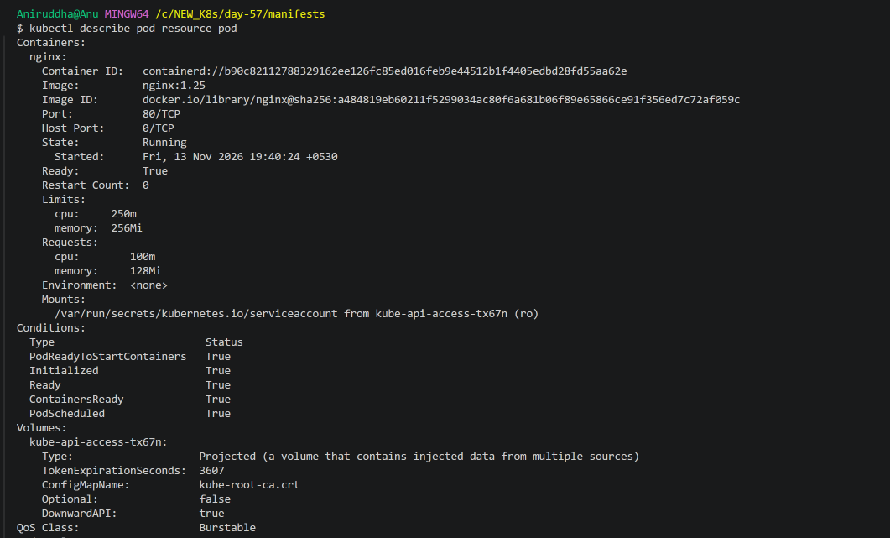
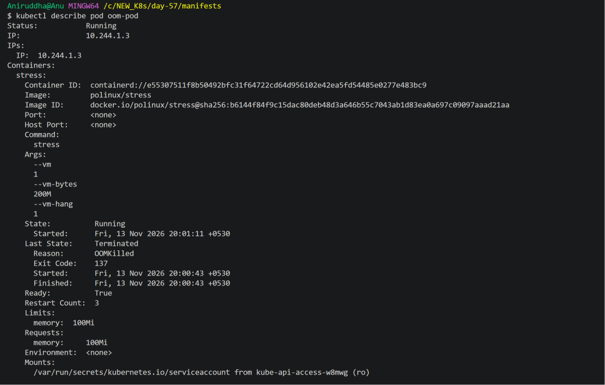
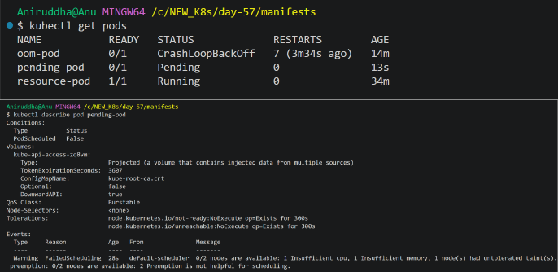
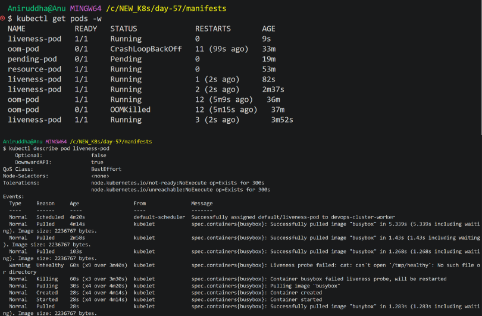
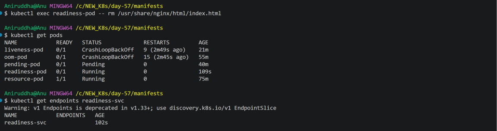
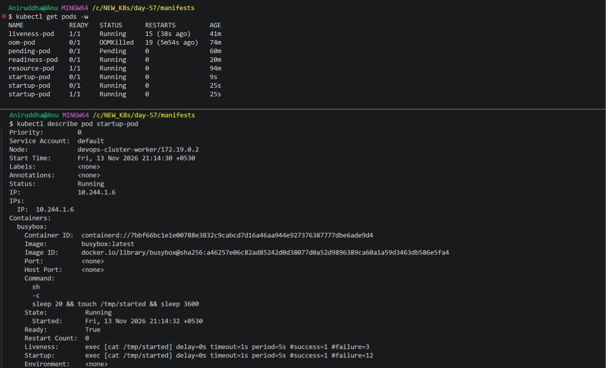
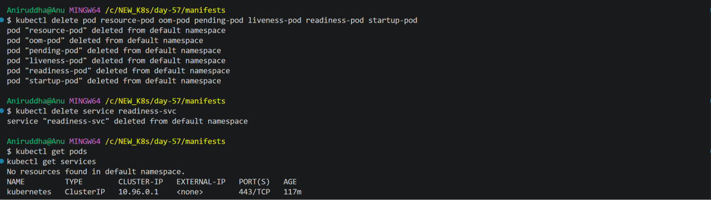

# Day 57 - Kubernetes Resource Requests, Limits, and Probes

## Overview

On Day 57 of the 90 Days of DevOps challenge, I explored Kubernetes resource management and container health probes.

The practical exercises covered:

- CPU and memory requests and limits.
- Kubernetes Pod Quality of Service (QoS) classes.
- Understanding OOMKilled containers.
- Pod scheduling failures due to insufficient resources.
- Liveness probes.
- Readiness probes.
- Startup probes.
- Cleaning up Kubernetes resources.

## Environment

| Component | Details |
|---|---|
| Operating System | Windows 11 |
| Kubernetes Distribution | KIND |
| Cluster | devops-cluster |
| Kubernetes Version | v1.37.0 |
| Container Runtime | Docker Desktop / containerd |
| Terminal | Git Bash |
| Editor | Visual Studio Code |

---

## Task 1 - Resource Requests and Limits

### Objective

Understand how Kubernetes manages CPU and memory resources using requests and limits.

### Manifest: `resource-pod.yml`

```yaml
apiVersion: v1
kind: Pod
metadata:
  name: resource-pod
spec:
  containers:
    - name: nginx
      image: nginx:1.25
      ports:
        - containerPort: 80
      resources:
        requests:
          cpu: "100m"
          memory: "128Mi"
        limits:
          cpu: "250m"
          memory: "256Mi"
```

### Apply the manifest

```bash
kubectl apply -f resource-pod.yml
```

Verify the Pod:

```bash
kubectl get pods
```

Inspect resource configuration:

```bash
kubectl describe pod resource-pod
```

### Observations

The Pod was successfully created and reached the Running state.

The configured resources were:

| Resource | Request | Limit |
|---|---:|---:|
| CPU | 100m | 250m |
| Memory | 128Mi | 256Mi |

The Pod had the following QoS class:

```text
QoS Class: Burstable
```

### Key Concepts

**Requests**

- Requests define the amount of CPU and memory Kubernetes uses when scheduling a Pod.
- The scheduler checks whether a node has enough allocatable resources to satisfy the requests.

**Limits**

- Limits define the maximum CPU and memory resources a container can consume.
- CPU is throttled when the container reaches its CPU limit.
- A container exceeding its memory limit can be terminated by the OOM killer.

**CPU units**

- `100m` means 100 millicores.
- 1000m equals 1 CPU core.
- Therefore, 100m equals 0.1 CPU core.

**QoS Classes**

Kubernetes provides three QoS classes:

| QoS Class | Description |
|---|---|
| Guaranteed | Every container has CPU and memory requests equal to their limits. |
| Burstable | At least one resource request or limit is configured, but the requirements for Guaranteed are not met. |
| BestEffort | No CPU or memory requests or limits are configured. |

### Screenshot



---

## Task 2 - Demonstrating OOMKilled

### Objective

Understand what happens when a container attempts to consume more memory than its configured memory limit.

### Manifest: `oom-pod.yml`

```yaml
apiVersion: v1
kind: Pod
metadata:
  name: oom-pod
spec:
  containers:
    - name: stress
      image: polinux/stress
      command: ["stress"]
      args: ["--vm", "1", "--vm-bytes", "200M", "--vm-hang", "1"]
      resources:
        limits:
          memory: "100Mi"
```

### Apply the manifest

```bash
kubectl apply -f oom-pod.yml
```

Observe the Pod:

```bash
kubectl get pods -w
```

Inspect its details:

```bash
kubectl describe pod oom-pod
```

Verify the last termination reason and exit code:

```bash
kubectl get pod oom-pod -o jsonpath='{.status.containerStatuses[0].lastState.terminated.reason}{"\n"}{.status.containerStatuses[0].lastState.terminated.exitCode}{"\n"}'
```

### Observed Output

```text
OOMKilled
137
```

The Pod repeatedly restarted because the stress process attempted to allocate approximately 200 MB of memory while the container had a memory limit of 100Mi.

The container's last termination reason was:

```text
Reason: OOMKilled
Exit Code: 137
```

### Key Concepts

**What is OOMKilled?**

OOM stands for Out Of Memory.

When a container exceeds its memory limit, the Linux OOM mechanism can terminate the process.

**Understanding exit code 137**

137 is commonly calculated as:

```text
128 + 9 = 137
```

Signal 9 is SIGKILL.

An exit code of 137 alone does not prove an OOM event. Always inspect the termination reason to distinguish OOMKilled from other SIGKILL situations.

### Screenshot



---

## Task 3 - Pending Pod Due to Insufficient Resources

### Objective

Understand how Kubernetes scheduling works when a Pod requests more resources than the available nodes can provide.

### Manifest: `pending-pod.yml`

```yaml
apiVersion: v1
kind: Pod
metadata:
  name: pending-pod
spec:
  containers:
    - name: nginx
      image: nginx:1.25
      resources:
        requests:
          cpu: "100"
          memory: "128Gi"
```

### Apply the manifest

```bash
kubectl apply -f pending-pod.yml
```

Check the Pod:

```bash
kubectl get pods
```

Inspect scheduling events:

```bash
kubectl describe pod pending-pod
```

### Observed Output

The Pod remained in the Pending state.

The scheduler reported:

```text
Warning FailedScheduling

0/2 nodes are available:
1 Insufficient cpu,
1 Insufficient memory,
1 node(s) had untolerated taint(s).
```

### Why did this happen?

The CPU request was configured as:

```yaml
cpu: "100"
```

This means 100 CPU cores, not 100 millicores.

The memory request was:

```yaml
memory: "128Gi"
```

This requests 128 GiB of memory.

The cluster could not satisfy these resource requests.

The control-plane node also had an untolerated taint, which prevented this Pod from being scheduled there.

### Key Concepts

- The scheduler uses resource requests to determine whether a Pod can fit on a node.
- A Pod remains Pending if it cannot be scheduled.
- `FailedScheduling` events help identify the reason.
- Preemption may not help if available resources still cannot satisfy the Pod's requests.

### Screenshot



---

## Task 4 - Liveness Probe

### Objective

Understand how Kubernetes checks whether a container is still healthy and restarts it when the liveness probe repeatedly fails.

### Manifest: `liveness-pod.yml`

```yaml
apiVersion: v1
kind: Pod
metadata:
  name: liveness-pod
spec:
  containers:
    - name: busybox
      image: busybox:latest
      command:
        - sh
        - -c
        - "touch /tmp/healthy && sleep 30 && rm /tmp/healthy && sleep 3600"
      livenessProbe:
        exec:
          command:
            - cat
            - /tmp/healthy
        periodSeconds: 5
        failureThreshold: 3
```

### Apply the manifest

```bash
kubectl apply -f liveness-pod.yml
```

Watch the Pod:

```bash
kubectl get pods -w
```

Inspect probe configuration and events:

```bash
kubectl describe pod liveness-pod
```

### How does it work?

1. The container starts.
2. It creates `/tmp/healthy`.
3. The liveness probe checks whether the file exists every five seconds.
4. After 30 seconds, the container removes the file.
5. The liveness probe starts failing.
6. After three consecutive failures, Kubernetes restarts the container.

### Observed Output

The Pod's restart count increased as the liveness probe repeatedly failed.

The events included:

```text
Warning  Unhealthy
Liveness probe failed:
cat: can't open '/tmp/healthy': No such file or directory
```

Kubernetes also reported:

```text
Normal  Killing
Container busybox failed liveness probe, will be restarted
```

### Key Concept

A failed liveness probe causes Kubernetes to restart the container after the configured failure threshold is reached.

A liveness probe is useful for detecting containers that are running but no longer functioning correctly.

### Screenshot



---

## Task 5 - Readiness Probe

### Objective

Understand how Kubernetes determines whether a container is ready to receive traffic.

### Manifest: `readiness-pod.yml`

```yaml
apiVersion: v1
kind: Pod
metadata:
  name: readiness-pod
  labels:
    app: readiness-test
spec:
  containers:
    - name: nginx
      image: nginx:1.25
      ports:
        - containerPort: 80
      readinessProbe:
        httpGet:
          path: /
          port: 80
        periodSeconds: 5
```

### Apply the manifest

```bash
kubectl apply -f readiness-pod.yml
```

Check the Pod:

```bash
kubectl get pod readiness-pod
```

### Create a Service

```bash
kubectl expose pod readiness-pod --port=80 --name=readiness-svc
```

Verify the Service:

```bash
kubectl get services
```

Check its endpoints:

```bash
kubectl get endpoints readiness-svc
```

Initially, the Service endpoint contained the Pod IP and port:

```text
10.244.1.5:80
```

### Simulate a readiness failure

Remove the default Nginx index page:

```bash
kubectl exec readiness-pod -- rm /usr/share/nginx/html/index.html
```

Wait for the readiness probe to detect the failure.

Check the Pod:

```bash
kubectl get pods
```

Check the Service endpoints again:

```bash
kubectl get endpoints readiness-svc
```

Inspect the Pod:

```bash
kubectl describe pod readiness-pod
```

### Observed Output

The Pod remained Running, but its READY status changed to `0/1`.

```text
readiness-pod   0/1   Running   0
```

The Service endpoints became empty:

```text
NAME            ENDPOINTS
readiness-svc
```

The Pod description showed:

```text
Ready:          False
Restart Count:  0
```

The readiness probe reported an HTTP 403 response after the default index page was removed.

### Key Concepts

A readiness probe determines whether a Pod should receive traffic.

When the readiness probe fails:

- The container continues running.
- Kubernetes marks the Pod as not ready.
- The Pod is removed from the Service's eligible endpoints.
- The container is not restarted just because of a readiness failure.

### Liveness vs Readiness

| Liveness Probe | Readiness Probe |
|---|---|
| Checks whether the container is healthy. | Checks whether the container can receive traffic. |
| Failure causes a container restart after the threshold. | Failure removes the Pod from Service endpoints. |
| Helps recover unhealthy containers. | Prevents traffic from reaching unready containers. |

### Screenshot



---

## Task 6 - Startup Probe

### Objective

Understand how Kubernetes allows applications enough time to initialize before enabling liveness and readiness checks.

### Manifest: `startup-pod.yml`

```yaml
apiVersion: v1
kind: Pod
metadata:
  name: startup-pod
spec:
  containers:
    - name: busybox
      image: busybox:latest
      command:
        - sh
        - -c
        - "sleep 20 && touch /tmp/started && sleep 3600"
      startupProbe:
        exec:
          command:
            - cat
            - /tmp/started
        periodSeconds: 5
        failureThreshold: 12
      livenessProbe:
        exec:
          command:
            - cat
            - /tmp/started
        periodSeconds: 5
        failureThreshold: 3
```

### Apply the manifest

```bash
kubectl apply -f startup-pod.yml
```

Watch the Pod:

```bash
kubectl get pods -w
```

Inspect the Pod:

```bash
kubectl describe pod startup-pod
```

### How does it work?

1. The container starts.
2. The command waits for 20 seconds.
3. During this period, `/tmp/started` does not exist.
4. The startup probe checks for the file every five seconds.
5. After 20 seconds, the command creates `/tmp/started`.
6. The startup probe succeeds.
7. Kubernetes then allows the liveness probe to become active.

While a startup probe has not succeeded, Kubernetes does not run the liveness or readiness probes for that container.

### Observed Output

The Pod initially showed:

```text
startup-pod   0/1   Running   0
```

After initialization:

```text
startup-pod   1/1   Running   0
```

The Pod description showed:

```text
Ready:          True
Restart Count:  0
```

The events included startup probe failures while the application was initializing:

```text
Warning  Unhealthy
Startup probe failed:
cat: can't open '/tmp/started': No such file or directory
```

There were four recorded startup probe failures, but the container was not restarted because the configured failure threshold was 12.

### Key Concepts

A startup probe protects slow-starting applications from premature liveness and readiness checks.

The startup probe provides a startup failure budget based on:

```text
periodSeconds × failureThreshold
```

In this lab:

```text
5 seconds × 12 = 60 seconds
```

This provides an approximate 60-second startup-probe failure budget.

If the application takes longer than the allowed startup period, Kubernetes can restart the container.

### Screenshot



---

## Task 7 - Cleanup

### Objective

Remove all Pods and Services created during the Day 57 exercises.

### Delete all Pods

```bash
kubectl delete pod resource-pod oom-pod pending-pod liveness-pod readiness-pod startup-pod
```

### Delete the Service

```bash
kubectl delete service readiness-svc
```

### Verify cleanup

```bash
kubectl get pods
kubectl get services
```

### Observed Result

```text
No resources found in default namespace.
```

Only the built-in Kubernetes Service remained:

```text
NAME         TYPE        CLUSTER-IP   EXTERNAL-IP   PORT(S)
kubernetes   ClusterIP   10.96.0.1   <none>        443/TCP
```

All application Pods and the Readiness Service were successfully deleted.

### Screenshot



---

## Day 57 - What I Learned

Through these practical exercises, I learned:

1. How Kubernetes uses CPU and memory requests and limits.
2. The difference between Guaranteed, Burstable, and BestEffort QoS classes.
3. How memory limits can cause OOMKilled container terminations.
4. How insufficient resource requests can prevent Pod scheduling.
5. How liveness probes detect unhealthy containers and trigger restarts.
6. How readiness probes control whether Pods receive Service traffic.
7. How startup probes protect applications that need additional initialization time.
8. How to inspect Pod conditions, events, restart counts, and probe configurations using `kubectl describe`.

## Resources

- [Kubernetes Documentation - Resource Management for Pods and Containers](https://kubernetes.io/docs/concepts/configuration/manage-resources-containers/)
- [Kubernetes Documentation - Liveness, Readiness, and Startup Probes](https://kubernetes.io/docs/concepts/configuration/liveness-readiness-startup-probes/)
- [Kubernetes Documentation - Pod Lifecycle](https://kubernetes.io/docs/concepts/workloads/pods/pod-lifecycle/)

---

**Challenge:** 90 Days of DevOps

**Day:** 57

**Topic:** Kubernetes Resource Requests, Limits, and Probes

**Status:** Completed